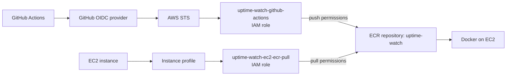

# DevOps Learning Playground

This project is my playground for learning DevOps. It is where I practice the workflows, automation, and operational thinking behind modern software delivery.

The application is a small website-availability tracking service, inspired by tools like Uptime Kuma. It serves as a learning substrate for understanding monitoring, automation, and deployment-oriented engineering practices.

## What I have built so far

### 1. Git workflow automation — 2026-10-25

- Trace: [snapshot at df246b4](https://github.com/AboubakrLaid/uptime-watch/tree/df246b4)
- Built a custom branch-and-push skill in `.github/skills/branch-and-push/SKILL.md`
- Detects the current working directory
- Suggests a branch name and commit message
- Helps structure the branch-and-push workflow for any code change

### 2. CI for automated validation — 2026-10-25

- Trace: [snapshot at 4c0cb6d](https://github.com/AboubakrLaid/uptime-watch/tree/4c0cb6d)
- Implemented a CI pipeline in `.github/workflows/pytest.yml`
- Runs validation automatically on code changes
- Helps enforce quality gates before merge
- Builds confidence through repeatable checks

### 3. Health checks and startup validation — 2026-10-27

- Trace: [snapshot at f32fd8d](https://github.com/AboubakrLaid/uptime-watch/tree/f32fd8d)
- health check
  - `/health/ready/` runs a real DB query `SELECT 1` to make sure the database is usable, not only reachable
  - `/health/deep/` is used to check whether other services are reachable, such as Redis, Celery, or Elasticsearch, and can be expanded later if needed
  - A health check should fail for the same reasons a real request fails, not just because the process is running
  - If the app cannot use its dependencies, it should return `503` instead of pretending to be healthy
- startup validation
  - It goes beyond checking whether the database is reachable; it confirms the database is actually usable
  - It makes sure the app can connect to the database and execute a real query during startup
  - This helps fail fast during deployment instead of starting a service that looks alive but is not ready to serve traffic

### 4. Basic deployment — 2026-10-28

- Trace: [snapshot at dc3aec7](https://github.com/AboubakrLaid/uptime-watch/tree/dc3aec7)
- Added Nginx to the Docker Compose setup and made it the entry point for the application.
- Kept the API service internal and exposed it only through Nginx.
- Configured SSL for secure HTTPS access.
- Added Nginx logs for access, errors, and related operational visibility.
- Linked the EC2 instance to an Elastic IP so the domain keeps pointing to the same public address even if the instance is stopped and restarted.
- The deployment process is still manual:
  1. Connect to the EC2 instance over SSH.
  2. Install the required system packages and tools, including Docker.
  3. Clone the repository from GitHub.
  4. Configure the application environment variables in the .env file.
  5. Start the Docker containers.
  6. Run the database migrations.
- The architecture now runs through Docker Compose with three containers: Nginx, API, and database. They communicate through a Docker network, and Nginx is the only public entry point to the application.


### 5. Multi-environment Docker setup — 2026-11-01

- Trace: [snapshot at cff9225](https://github.com/AboubakrLaid/uptime-watch/tree/cff9225)
- I am using two Docker Compose configurations.
- The production setup includes `api`, `db`, and `nginx`.
- The default setup includes `app` and `db`.

### 6. Developement to main release flow — 2026-11-03

- Trace: [snapshot at f493514](https://github.com/AboubakrLaid/uptime-watch/tree/f493514)
- All changes are merged into developement during normal work.
- When it is time to deploy, developement is merged into main.
- The main branch push triggers building the app Docker image and pushing it to AWS ECR.
- This gives a simple, predictable deployment flow.

### 7. Semi-automated deployment — 2026-11-04

- Trace: [snapshot at 1e0ccdd](https://github.com/AboubakrLaid/uptime-watch/tree/1e0ccdd)
- Pushing to main triggers the build and publish flow for the application image in Amazon ECR.
- Added a deployment script on EC2 that authenticates Docker with ECR, checks out the target branch, and pulls the published app image.
- Updated the production Docker Compose setup to use the published image through the APP_IMAGE variable instead of building the app image on the server.
- The deployment step also starts the app container, runs Django migrations, and collects static files so the new release is ready to serve.
- This creates a simple semi-automated release flow: GitHub Actions handles image publication, while EC2 runs the final pull-and-start step for deployment.


## Notes

This is my practical AWS reference for the exact setup I configured around this project. It focuses only on the parts I actually use: EC2, Amazon ECR, IAM trust and permissions, GitHub OIDC, and the authentication boundaries between them.

---

### 1. EC2

My EC2 instance is the runtime host for the application image. It does not own the build pipeline; it pulls the image that GitHub Actions has already published to ECR.

Why it needs an IAM role:

- GitHub Actions publishes the image to ECR.
- EC2 retrieves the image from ECR.
- Those are different responsibilities and should use different AWS identities.

The EC2 role I am using for this is:

```text
uptime-watch-ec2-ecr-pull
```

Status: this role should be verified in AWS before assuming it has already been created and attached to the instance profile.

The role is attached through an EC2 instance profile. The instance profile is what connects the IAM role to the instance. The instance itself does not hold a permanent AWS access key.

Instead, EC2 gets temporary credentials from AWS through the instance metadata service. The AWS CLI on the instance uses those credentials to call AWS APIs.

The operational flow is:

```bash
aws ecr get-login-password --region eu-west-3   | docker login --username AWS --password-stdin     373080580380.dkr.ecr.eu-west-3.amazonaws.com
```

This is the boundary where AWS authentication and Docker authentication are separate but related:

- AWS authentication: the EC2 instance uses its IAM role to get temporary credentials.
- Docker authentication: Docker uses the ECR authorization token to log in to the registry.

To verify the EC2 identity:

```bash
aws sts get-caller-identity
```

This should show a temporary session from the EC2 instance role, not a long-lived IAM user.

Important distinction:

- EC2 instance = the server
- IAM role = the permissions identity attached to the instance
- Instance profile = the attachment mechanism that gives the instance that role

---

### 2. Amazon ECR

My actual ECR configuration is:

| Setting        | Value                                          |
| -------------- | ---------------------------------------------- |
| AWS account ID | `373080580380`                                 |
| AWS region     | `eu-west-3`                                    |
| Registry       | `373080580380.dkr.ecr.eu-west-3.amazonaws.com` |
| Repository     | `uptime-watch`                                 |

I use ECR as the private image registry for my project because GitHub Actions builds the image and EC2 later retrieves it. That keeps the build and runtime responsibilities separate and avoids storing images directly on EC2.

GitHub Actions pushes to:

```text
373080580380.dkr.ecr.eu-west-3.amazonaws.com/uptime-watch
```

EC2 pulls from the same repository.

The actual workflow does this:

```yaml
permissions:
  id-token: write
  contents: read
```

```yaml
- name: Configure AWS credentials with OIDC
  uses: aws-actions/configure-aws-credentials@v4
  with:
    role-to-assume: arn:aws:iam::373080580380:role/uptime-watch-github-actions
    aws-region: eu-west-3
```

Then:

```bash
aws ecr get-login-password --region "$AWS_REGION"   | docker login --username AWS --password-stdin "$ECR_REGISTRY"
```

and finally:

```bash
docker build -t "$ECR_REPOSITORY:$IMAGE_TAG" .
docker push "$ECR_REGISTRY/$ECR_REPOSITORY:$IMAGE_TAG"
```

The workflow creates two tags for the same image:

```bash
IMAGE_TAG="upwatch-back-$(date -u +%Y%m%d-%H%M%S)-${GITHUB_SHA:0:7}"
```

Then it also adds:

```bash
docker tag "$ECR_REPOSITORY:$IMAGE_TAG"   "$ECR_REGISTRY/$ECR_REPOSITORY:latest"
```

Result:

```text
uptime-watch
├── upwatch-back-20261104-143000-a81f23c
└── latest
```

Those are not two separate image copies. When published together, both tags point to the same underlying image digest. The digest is the real content identity; the tag is just a human-readable label.

Why keep both tags:

- `upwatch-back-...` = specific build, traceable and easy to select
- `latest` = convenient default pointer, but mutable and less precise

For deployment decisions, the version-specific tag is more useful because it identifies a concrete build. `latest` is convenient for quick access, but it is not the best choice when I need to know exactly which image was deployed.

---

### 3. IAM

This is the most important part of the setup.

The key idea is: a role is not enough by itself. The trust policy decides who can assume it, and the permissions policy decides what it can do after it is assumed.

#### 3.1 GitHub OIDC identity provider

I created this identity provider in AWS:

| Setting       | Value                                                                         |
| ------------- | ----------------------------------------------------------------------------- |
| Provider      | `token.actions.githubusercontent.com`                                         |
| Provider type | OpenID Connect                                                                |
| Audience      | `sts.amazonaws.com`                                                           |
| ARN           | `arn:aws:iam::373080580380:oidc-provider/token.actions.githubusercontent.com` |

Why AWS needs it:

- AWS must know that GitHub is a trusted external identity source.
- Without this, GitHub Actions cannot present a workload identity to AWS.

Why this matters for my project:

- GitHub Actions does not use static AWS keys.
- It requests an OIDC token from GitHub.
- AWS STS validates that token and decides whether the workflow is allowed to assume my IAM role.

The flow is:

```text
GitHub Actions
  -> requests OIDC token
  -> GitHub OIDC provider
  -> AWS STS
  -> temporary credentials
  -> workflow can access permitted AWS resources
```

This is safer than long-lived AWS access keys in GitHub secrets because the credentials are temporary and tied to a specific repository and branch.

#### 3.2 GitHub Actions IAM role

Role:

```text
uptime-watch-github-actions
arn:aws:iam::373080580380:role/uptime-watch-github-actions
```

This role allows GitHub Actions to authenticate to AWS and push the Docker image to ECR.

Trust policy:

```json
{
  "Version": "2012-10-17",
  "Statement": [
    {
      "Effect": "Allow",
      "Principal": {
        "Federated": "arn:aws:iam::373080580380:oidc-provider/token.actions.githubusercontent.com"
      },
      "Action": "sts:AssumeRoleWithWebIdentity",
      "Condition": {
        "StringEquals": {
          "token.actions.githubusercontent.com:aud": "sts.amazonaws.com",
          "token.actions.githubusercontent.com:sub": "repo:AboubakrLaid@107946074/uptime-watch@1433115526:ref:refs/heads/main"
        }
      }
    }
  ]
}
```

What this controls:

- trusted principal = GitHub OIDC provider
- action = `sts:AssumeRoleWithWebIdentity`
- audience must be `sts.amazonaws.com`
- subject must match this exact GitHub repository and branch

This means GitHub can assume the role only if the token is for my repo and for `main`.

The repository identity in the trust policy is:

```text
Repository: AboubakrLaid/uptime-watch
Owner ID: 107946074
Repository ID: 1433115526
Branch: main
```

The numeric owner and repo identifiers are included so AWS can match the exact GitHub identity rather than accepting a looser repository name pattern.

Permissions policy:

```json
{
  "Version": "2012-10-17",
  "Statement": [
    {
      "Sid": "AllowEcrAuthorization",
      "Effect": "Allow",
      "Action": "ecr:GetAuthorizationToken",
      "Resource": "*"
    },
    {
      "Sid": "AllowRepositoryPush",
      "Effect": "Allow",
      "Action": [
        "ecr:DescribeRepositories",
        "ecr:BatchCheckLayerAvailability",
        "ecr:InitiateLayerUpload",
        "ecr:UploadLayerPart",
        "ecr:CompleteLayerUpload",
        "ecr:PutImage"
      ],
      "Resource": "arn:aws:ecr:eu-west-3:373080580380:repository/uptime-watch"
    }
  ]
}
```

Why these permissions are needed:

- `ecr:GetAuthorizationToken` is a registry-level request, so it is allowed with `Resource: "*"`.
- The other actions are repository-scoped to my ECR repository.
- This role is allowed to push images, not read from the repository for normal deployment actions.

This distinction matters:

- Trust policy decides whether GitHub can assume the role.
- Permissions policy decides whether the assumed identity can push an image.

A role can be trusted and still fail if it lacks the required ECR permissions.

#### 3.3 EC2 IAM role

Role:

```text
uptime-watch-ec2-ecr-pull
```

Status: this role still needs verification in AWS before assuming it is already created and attached to the EC2 instance.

This role is different from the GitHub role because it is for runtime image retrieval, not image publishing.

Trust policy:

```json
{
  "Version": "2012-10-17",
  "Statement": [
    {
      "Effect": "Allow",
      "Principal": {
        "Service": "ec2.amazonaws.com"
      },
      "Action": "sts:AssumeRole"
    }
  ]
}
```

This trusts the EC2 service, not GitHub. AWS allows the EC2 service to assume the role when the instance is running. The instance profile is the mechanism that attaches that role to the instance.

Permissions policy:

```json
{
  "Version": "2012-10-17",
  "Statement": [
    {
      "Sid": "AllowEcrAuthorization",
      "Effect": "Allow",
      "Action": "ecr:GetAuthorizationToken",
      "Resource": "*"
    },
    {
      "Sid": "AllowRepositoryPull",
      "Effect": "Allow",
      "Action": [
        "ecr:BatchCheckLayerAvailability",
        "ecr:BatchGetImage",
        "ecr:GetDownloadUrlForLayer"
      ],
      "Resource": "arn:aws:ecr:eu-west-3:373080580380:repository/uptime-watch"
    }
  ]
}
```

Why this role only pulls:

- EC2 is allowed to authenticate to ECR and download image layers.
- It does not need image-publishing permissions.
- `ecr:GetAuthorizationToken` still uses `Resource: "*"` because it is a registry-level authorization request.
- The layer and manifest retrieval permissions are scoped to the repository that contains the image.

This is the main difference from the GitHub role:

- GitHub role = assume via GitHub OIDC, then push to ECR
- EC2 role = assume via EC2 service, then pull from ECR

---

### 4. How everything works together

#### Flow A — Publishing an image

1. I push or merge code into `main`.
2. GitHub Actions starts the workflow.
3. GitHub Actions requests an OIDC identity token.
4. AWS STS validates the token against the GitHub role trust policy.
5. GitHub Actions assumes `uptime-watch-github-actions` role.
6. AWS provides temporary credentials to the workflow.
7. The workflow authenticates Docker to ECR.
8. Docker pushes the image and tags to the ECR repository.
9. ECR stores the image and tag metadata.

#### Flow B — Retrieving an image

1. I run the deployment script on EC2.
2. AWS CLI gets temporary credentials from the instance role.
3. EC2 authenticates Docker to ECR.
4. Docker requests the image from the registry.
5. AWS checks the EC2 role permissions.
6. ECR allows the pull if the role is authorized for that repository.
7. Docker downloads the image layers and stores the image locally.
8. Docker Compose uses that image to start or recreate the application container.

At each boundary, the trust and permission model matters:

- OIDC provider validates GitHub identity
- trust policy decides whether the GitHub role can be assumed
- permissions policy decides whether the role can push images
- instance profile gives EC2 its role
- EC2 permissions decide whether it can pull images



The important part is that GitHub and EC2 use different roles for different jobs, even though they both talk to the same ECR repository.

---

### 5. Quick reference

| Item                 | Value                                                                         |
| -------------------- | ----------------------------------------------------------------------------- |
| AWS account ID       | `373080580380`                                                                |
| AWS region           | `eu-west-3`                                                                   |
| ECR registry         | `373080580380.dkr.ecr.eu-west-3.amazonaws.com`                                |
| ECR repository       | `uptime-watch`                                                                |
| GitHub OIDC provider | `arn:aws:iam::373080580380:oidc-provider/token.actions.githubusercontent.com` |
| GitHub role          | `arn:aws:iam::373080580380:role/uptime-watch-github-actions`                  |
| EC2 role             | `uptime-watch-ec2-ecr-pull` (verify in AWS)                                   |

Verify AWS identity:

```bash
aws sts get-caller-identity
```

Check the ECR repository:

```bash
aws ecr describe-repositories   --repository-names uptime-watch   --region eu-west-3
```

Check image metadata and digests:

```bash
aws ecr describe-images   --repository-name uptime-watch   --region eu-west-3   --output table
```

List the tags in the repository:

```bash
aws ecr list-images   --repository-name uptime-watch   --region eu-west-3
```

Authenticate Docker to ECR:

```bash
aws ecr get-login-password --region eu-west-3   | docker login --username AWS --password-stdin     373080580380.dkr.ecr.eu-west-3.amazonaws.com
```

Pull a specific image:

```bash
docker pull 373080580380.dkr.ecr.eu-west-3.amazonaws.com/uptime-watch:latest
```

---

This is the part I need to remember: GitHub uses OIDC to assume a push role, EC2 uses an instance profile role to assume a pull role, and both are connected through the same ECR repository. The trust policy tells AWS who may assume the role; the permissions policy tells AWS what that role may do after it is assumed.
