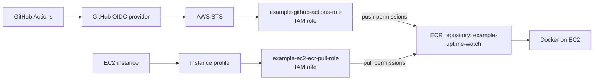

# Technical Reference

## Notes


This is my practical AWS reference for the exact setup I configured around this project. It focuses only on the parts I actually use: EC2, Amazon ECR, IAM trust and permissions, GitHub OIDC, and the authentication boundaries between them.

---

### 1. EC2

My EC2 instance is the runtime host for the application image. It does not own the build pipeline; it pulls the image that GitHub Actions has already published to ECR.

Why it needs an IAM role:

- GitHub Actions publishes the image to ECR.
- EC2 retrieves the image from ECR.
- Those are different responsibilities and should use different AWS identities.

The EC2 role I am using for this is:

```text
uptime-watch-ec2-ecr-pull
```

Status: this role should be verified in AWS before assuming it has already been created and attached to the instance profile.

The role is attached through an EC2 instance profile. The instance profile is what connects the IAM role to the instance. The instance itself does not hold a permanent AWS access key.

Instead, EC2 gets temporary credentials from AWS through the instance metadata service. The AWS CLI on the instance uses those credentials to call AWS APIs.

The operational flow is:

```bash
aws ecr get-login-password --region eu-west-3   | docker login --username AWS --password-stdin     <AWS_ACCOUNT_ID>.dkr.ecr.eu-west-3.amazonaws.com
```

This is the boundary where AWS authentication and Docker authentication are separate but related:

- AWS authentication: the EC2 instance uses its IAM role to get temporary credentials.
- Docker authentication: Docker uses the ECR authorization token to log in to the registry.

To verify the EC2 identity:

```bash
aws sts get-caller-identity
```

This should show a temporary session from the EC2 instance role, not a long-lived IAM user.

Important distinction:

- EC2 instance = the server
- IAM role = the permissions identity attached to the instance
- Instance profile = the attachment mechanism that gives the instance that role

---

### 2. Amazon ECR

My example ECR configuration is:

| Setting        | Value                                          |
| -------------- | ---------------------------------------------- |
| AWS account ID | `123456789012`                                 |
| AWS region     | `eu-west-1`                                    |
| Registry       | `123456789012.dkr.ecr.eu-west-1.amazonaws.com` |
| Repository     | `example-uptime-watch`                         |

I use ECR as the private image registry for my project because GitHub Actions builds the image and EC2 later retrieves it. That keeps the build and runtime responsibilities separate and avoids storing images directly on EC2.

GitHub Actions pushes to:

```text
123456789012.dkr.ecr.eu-west-1.amazonaws.com/example-uptime-watch
```

EC2 pulls from the same repository.

The actual workflow does this:

```yaml
permissions:
  id-token: write
  contents: read
```

```yaml
- name: Configure AWS credentials with OIDC
  uses: aws-actions/configure-aws-credentials@v4
  with:
    role-to-assume: arn:aws:iam::123456789012:role/example-github-actions-role
    aws-region: eu-west-1
```

Then:

```bash
aws ecr get-login-password --region "$AWS_REGION"   | docker login --username AWS --password-stdin "$ECR_REGISTRY"
```

and finally:

```bash
docker build -t "$ECR_REPOSITORY:$IMAGE_TAG" .
docker push "$ECR_REGISTRY/$ECR_REPOSITORY:$IMAGE_TAG"
```

The workflow creates two tags for the same image:

```bash
IMAGE_TAG="upwatch-back-$(date -u +%Y%m%d-%H%M%S)-${GITHUB_SHA:0:7}"
```

Then it also adds:

```bash
docker tag "$ECR_REPOSITORY:$IMAGE_TAG"   "$ECR_REGISTRY/$ECR_REPOSITORY:latest"
```

Result:

```text
example-uptime-watch
├── upwatch-back-20261104-143000-a81f23c
└── latest
```

Those are not two separate image copies. When published together, both tags point to the same underlying image digest. The digest is the real content identity; the tag is just a human-readable label.

Why keep both tags:

- `upwatch-back-...` = specific build, traceable and easy to select
- `latest` = convenient default pointer, but mutable and less precise

For deployment decisions, the version-specific tag is more useful because it identifies a concrete build. `latest` is convenient for quick access, but it is not the best choice when I need to know exactly which image was deployed.

---

### 3. IAM

This is the most important part of the setup.

The key idea is: a role is not enough by itself. The trust policy decides who can assume it, and the permissions policy decides what it can do after it is assumed.

#### 3.1 GitHub OIDC identity provider

I created this identity provider in AWS:

| Setting       | Value                                                                         |
| ------------- | ----------------------------------------------------------------------------- |
| Provider      | `token.actions.githubusercontent.com`                                         |
| Provider type | OpenID Connect                                                                |
| Audience      | `sts.amazonaws.com`                                                           |
| ARN           | `arn:aws:iam::123456789012:oidc-provider/token.actions.githubusercontent.com` |

Why AWS needs it:

- AWS must know that GitHub is a trusted external identity source.
- Without this, GitHub Actions cannot present a workload identity to AWS.

Why this matters for my project:

- GitHub Actions does not use static AWS keys.
- It requests an OIDC token from GitHub.
- AWS STS validates that token and decides whether the workflow is allowed to assume my IAM role.

The flow is:

```text
GitHub Actions
  -> requests OIDC token
  -> GitHub OIDC provider
  -> AWS STS
  -> temporary credentials
  -> workflow can access permitted AWS resources
```

This is safer than long-lived AWS access keys in GitHub secrets because the credentials are temporary and tied to a specific repository and branch.

#### 3.2 GitHub Actions IAM role

Role:

```text
example-github-actions-role
arn:aws:iam::123456789012:role/example-github-actions-role
```

This role allows GitHub Actions to authenticate to AWS and push the Docker image to ECR.

Trust policy:

```json
{
  "Version": "2012-10-17",
  "Statement": [
    {
      "Effect": "Allow",
      "Principal": {
        "Federated": "arn:aws:iam::123456789012:oidc-provider/token.actions.githubusercontent.com"
      },
      "Action": "sts:AssumeRoleWithWebIdentity",
      "Condition": {
        "StringEquals": {
          "token.actions.githubusercontent.com:aud": "sts.amazonaws.com",
          "token.actions.githubusercontent.com:sub": "repo:ExampleOrg@example-repo@123456789:ref:refs/heads/main"
        }
      }
    }
  ]
}
```

What this controls:

- trusted principal = GitHub OIDC provider
- action = `sts:AssumeRoleWithWebIdentity`
- audience must be `sts.amazonaws.com`
- subject must match this exact GitHub repository and branch

This means GitHub can assume the role only if the token is for my repo and for `main`.

The repository identity in the trust policy is:

```text
Repository: ExampleOrg/example-repo
Owner ID: 123456789
Repository ID: 123456789
Branch: main
```

The numeric owner and repo identifiers are included so AWS can match the exact GitHub identity rather than accepting a looser repository name pattern.

Permissions policy:

```json
{
  "Version": "2012-10-17",
  "Statement": [
    {
      "Sid": "AllowEcrAuthorization",
      "Effect": "Allow",
      "Action": "ecr:GetAuthorizationToken",
      "Resource": "*"
    },
    {
      "Sid": "AllowRepositoryPush",
      "Effect": "Allow",
      "Action": [
        "ecr:DescribeRepositories",
        "ecr:BatchCheckLayerAvailability",
        "ecr:InitiateLayerUpload",
        "ecr:UploadLayerPart",
        "ecr:CompleteLayerUpload",
        "ecr:PutImage"
      ],
      "Resource": "arn:aws:ecr:eu-west-1:123456789012:repository/example-uptime-watch"
    }
  ]
}
```

Why these permissions are needed:

- `ecr:GetAuthorizationToken` is a registry-level request, so it is allowed with `Resource: "*"`.
- The other actions are repository-scoped to my ECR repository.
- This role is allowed to push images, not read from the repository for normal deployment actions.

This distinction matters:

- Trust policy decides whether GitHub can assume the role.
- Permissions policy decides whether the assumed identity can push an image.

A role can be trusted and still fail if it lacks the required ECR permissions.

##### SES email-sending permission

The same GitHub Actions role is also authorized to send email through Amazon Simple Email Service (SES). Its custom policy is named `uptime-watch-github-actions-ses-send` and allows the `ses:SendEmail` action. A simplified version of the SES statement is:

```json
{
  "Effect": "Allow",
  "Action": "ses:SendEmail",
  "Resource": [
    "arn:aws:ses:eu-west-3:<AWS_ACCOUNT_ID>:identity/upwatch.live",
    "arn:aws:ses:eu-west-3:<AWS_ACCOUNT_ID>:identity/<VERIFIED_RECIPIENT_EMAIL>"
  ],
  "Condition": {
    "StringEquals": {
      "ses:FromAddress": "alerts@upwatch.live"
    }
  }
}
```

The SES identity ARNs scope the permission to the identities included in this policy. The `ses:FromAddress` condition separately limits the sender address the role may use. Including a recipient email identity ARN in `Resource` does not itself express a destination-recipient restriction; SES has a separate `ses:Recipients` condition key for that purpose. This policy's `ses:FromAddress` condition is a sender restriction, not a recipient restriction.

These are separate authorization checks:

- The OIDC trust policy determines whether the GitHub workflow can assume the role.
- The role's permissions policy determines whether its temporary credentials may call `ses:SendEmail`.
- SES identity verification and account sending status determine whether SES will accept the sender and destination for delivery.

Successful OIDC authentication therefore does not imply permission to send email. Likewise, IAM permission does not verify an SES identity or remove sandbox restrictions.

#### 3.3 EC2 IAM role

Role:

```text
example-ec2-ecr-pull-role
```

Status: this role is a sample setup for a runtime pull identity and does not reflect a live AWS configuration.

This role is different from the GitHub role because it is for runtime image retrieval, not image publishing.

Trust policy:

```json
{
  "Version": "2012-10-17",
  "Statement": [
    {
      "Effect": "Allow",
      "Principal": {
        "Service": "ec2.amazonaws.com"
      },
      "Action": "sts:AssumeRole"
    }
  ]
}
```

This trusts the EC2 service, not GitHub. AWS allows the EC2 service to assume the role when the instance is running. The instance profile is the mechanism that attaches that role to the instance.

Permissions policy:

```json
{
  "Version": "2012-10-17",
  "Statement": [
    {
      "Sid": "AllowEcrAuthorization",
      "Effect": "Allow",
      "Action": "ecr:GetAuthorizationToken",
      "Resource": "*"
    },
    {
      "Sid": "AllowRepositoryPull",
      "Effect": "Allow",
      "Action": [
        "ecr:BatchCheckLayerAvailability",
        "ecr:BatchGetImage",
        "ecr:GetDownloadUrlForLayer"
      ],
      "Resource": "arn:aws:ecr:eu-west-1:123456789012:repository/example-uptime-watch"
    }
  ]
}
```

Why this role only pulls:

- EC2 is allowed to authenticate to ECR and download image layers.
- It does not need image-publishing permissions.
- `ecr:GetAuthorizationToken` still uses `Resource: "*"` because it is a registry-level authorization request.
- The layer and manifest retrieval permissions are scoped to the repository that contains the image.

This is the main difference from the GitHub role:

- GitHub role = assume via GitHub OIDC, then push to ECR
- EC2 role = assume via EC2 service, then pull from ECR

---

### 4. How everything works together

#### Flow A — Publishing an image

1. I push or merge code into `main`.
2. GitHub Actions starts the workflow.
3. GitHub Actions requests an OIDC identity token.
4. AWS STS validates the token against the GitHub role trust policy.
5. GitHub Actions assumes `example-github-actions-role`.
6. AWS provides temporary credentials to the workflow.
7. The workflow authenticates Docker to ECR.
8. Docker pushes the image and tags to the ECR repository.
9. ECR stores the image and tag metadata.

#### Flow B — Retrieving an image

1. I run the deployment script on EC2.
2. AWS CLI gets temporary credentials from the instance role.
3. EC2 authenticates Docker to ECR.
4. Docker requests the image from the registry.
5. AWS checks the EC2 role permissions.
6. ECR allows the pull if the role is authorized for that repository.
7. Docker downloads the image layers and stores the image locally.
8. Docker Compose uses that image to start or recreate the application container.

At each boundary, the trust and permission model matters:

- OIDC provider validates GitHub identity
- trust policy decides whether the GitHub role can be assumed
- permissions policy decides whether the role can push images
- instance profile gives EC2 its role
- EC2 permissions decide whether it can pull images



The important part is that GitHub and EC2 use different roles for different jobs, even though they both talk to the same ECR repository.

---

### 5. Quick reference

| Item                 | Value                                                                         |
| -------------------- | ----------------------------------------------------------------------------- |
| AWS account ID       | `123456789012`                                                                |
| AWS region           | `eu-west-1`                                                                   |
| ECR registry         | `123456789012.dkr.ecr.eu-west-1.amazonaws.com`                                |
| ECR repository       | `example-uptime-watch`                                                        |
| GitHub OIDC provider | `arn:aws:iam::123456789012:oidc-provider/token.actions.githubusercontent.com` |
| GitHub role          | `arn:aws:iam::123456789012:role/example-github-actions-role`                  |
| EC2 role             | `example-ec2-ecr-pull-role` (sample setup)                                    |

Verify AWS identity:

```bash
aws sts get-caller-identity
```

Check the ECR repository:

```bash
aws ecr describe-repositories   --repository-names example-uptime-watch   --region eu-west-1
```

Check image metadata and digests:

```bash
aws ecr describe-images   --repository-name example-uptime-watch   --region eu-west-1   --output table
```

List the tags in the repository:

```bash
aws ecr list-images   --repository-name example-uptime-watch   --region eu-west-1
```

Authenticate Docker to ECR:

```bash
aws ecr get-login-password --region eu-west-1   | docker login --username AWS --password-stdin     123456789012.dkr.ecr.eu-west-1.amazonaws.com
```

### 6. EC2 Storage Expansion — Troubleshooting "No space left on device"

The actual error:

```text
failed to extract layer ... to overlayfs:
write /var/lib/containerd/...:
no space left on device
```

#### 1. What I checked first

```bash
df -h
docker system df
sudo du -sh /var/lib/containerd
sudo du -sh /var/lib/docker
```

Actual output:

```text
Filesystem       Size  Used Avail Use% Mounted on
/dev/root        6.7G  4.0G  2.7G  61% /

TYPE            TOTAL     ACTIVE    SIZE      RECLAIMABLE
Images          2         2         839.3MB   0B (0%)
Containers      2         2         3.523MB   0B (0%)
Local Volumes   0         0         0B        0B
Build Cache     0         0         0B        0B

808M    /var/lib/containerd
597M    /var/lib/docker
```

The root filesystem only had `2.7G` free. Docker also had no reclaimable storage, so pruning was not the real fix. The bigger issue was that the host disk was simply too small for the image extraction step.

#### 2. What I confirmed before changing anything

```bash
docker ps -a
docker images
sudo lsblk
```

Relevant output:

```text
uptime-watch-app
uptime-watch-nginx

IMAGE                                      DISK USAGE
uptime-watch:latest                        765MB
nginx:1.27-alpine                          74.5MB

NAME         SIZE TYPE MOUNTPOINTS
nvme0n1       8G disk
├─nvme0n1p1  6.9G part /
├─nvme0n1p13 1023M part /boot
├─nvme0n1p14   4M part
└─nvme0n1p15  106M part /boot/efi
```

The disk looked 8 GB from AWS, but the root partition was only 6.9 GB. The root filesystem still had to be expanded.

The mental model was:

```text
EBS Volume → Partition → Filesystem
```

Increasing the EBS volume alone does not make extra space available to Linux. The partition and filesystem must also be resized.

#### 3. Fix that worked

Increase the EBS volume in AWS, then resize the root partition:

```bash
sudo growpart /dev/nvme0n1 1
```

Actual output:

```text
CHANGED: partition=1 start=2324480
old: size=14452703 end=16777182
new: size=22841311 end=25165790
```

Then expand the ext4 filesystem:

```bash
sudo resize2fs /dev/nvme0n1p1
```

Actual output:

```text
resize2fs 1.47.2 (1-Jan-2025)
Filesystem at /dev/nvme0n1p1 is mounted on /;
on-line resizing required
old_desc_blocks = 1, new_desc_blocks = 2
The filesystem on /dev/nvme0n1p1 is now 2855163 (4k) blocks long.
```

After resizing, the root filesystem was back to a healthy state:

```bash
df -h
df -hT
lsblk
```

Final relevant output:

```text
Filesystem       Size  Used Avail Use% Mounted on
/dev/root         11G  4.6G  6.0G  44% /
```

| Metric          | Before | After   |
| --------------- | ------ | ------- |
| Root partition  | 6.9 GB | 10.9 GB |
| Root filesystem | 6.7 GB | 11 GB   |
| Available space | 2.7 GB | 6.0 GB  |
| Usage           | 61%    | 44%     |

#### 4. Quick reminder

```bash
df -h
df -hT
lsblk
sudo growpart /dev/nvme0n1 1
sudo resize2fs /dev/nvme0n1p1
```

When this happens again, the workflow is:

```text
check free space → inspect Docker storage → inspect block devices → resize EBS → grow partition → resize filesystem → verify → retry deployment
```

#### 5. Lessons to keep

- `no space left on device` during pull/extract usually means local disk, not registry auth.
- Docker and containerd storage lives on the EC2 host filesystem.
- Expanding AWS volume size is only the first step; the partition and filesystem must also be expanded.
- `lsblk` is the first truth source before resizing.
- `resize2fs` is for ext filesystems; XFS uses another procedure.
- Never assume Docker cleanup is the solution when the root filesystem is the real bottleneck.

---

### 6. Amazon RDS integration

#### 1. VPC and private networking

A VPC is the AWS network boundary for the resources that belong together. EC2, RDS, subnets, route tables, and security groups all live inside a VPC, and the resources need to be in the same network context to talk to each other. In this project, the EC2 instance and the PostgreSQL database are in the same VPC in `eu-west-3`, so their private networking can work without exposing the database to the internet.

The practical reason this matters is simple: the app runs in a Docker container on EC2, but the database is not on the same machine or the same Docker network. The database is reached through the VPC and its private endpoint. The actual path is:

```text
Django container → EC2 host/network → VPC → RDS private endpoint → PostgreSQL
```

This is not Docker networking. It is AWS networking. The RDS endpoint is a private DNS name that resolves to a private IP inside the VPC, not a public address. A private IP is only routable inside the VPC and related network paths; it is not reachable from the public internet by default. That is why RDS can be private and still reachable from the application while not being publicly accessible.

The DNS piece matters because clients do not connect to a fixed IP; they connect to the hostname. For this instance, the endpoint is:

```text
uptime-watch-db-prod.cvi446um23kl.eu-west-3.rds.amazonaws.com
```

That hostname resolves in the VPC to the observed private IP:

```text
172.31.48.73
```

So the app resolves the RDS endpoint to a private address, then connects over the VPC network to the PostgreSQL service. The AWS region is `eu-west-3`, and the name is tied to the specific RDS instance created for this project.

#### 2. Security groups

A security group is a virtual firewall attached to an AWS resource. It is not a separate host firewall; it is the access policy that controls network traffic to and from the resource. Inbound rules decide what is allowed to enter; outbound rules decide what the resource is allowed to send out. For this project, security groups are the reason EC2 can reach RDS on PostgreSQL without exposing the database publicly.

Security groups are stateful. If EC2 initiates a TCP connection to PostgreSQL on port 5432, the response traffic is automatically allowed back in without needing a separate inbound rule for that response. This is why EC2 does not need a separate inbound PostgreSQL rule just to receive replies; the connection is already tracked as part of the allowed session.

My actual setup was:

| Security group | Type       | Protocol | Port   | Rule direction | Source / destination     |
| -------------- | ---------- | -------- | ------ | -------------- | ------------------------ |
| `ec2-rds-1`    | PostgreSQL | TCP      | `5432` | Outbound       | Destination: `rds-ec2-1` |
| `rds-ec2-1`    | PostgreSQL | TCP      | `5432` | Inbound        | Source: `ec2-rds-1`      |

This is the connection model I used:

- The EC2 security group `ec2-rds-1` allows outbound PostgreSQL traffic on TCP `5432`.
- The RDS security group `rds-ec2-1` allows inbound PostgreSQL traffic on TCP `5432` only from the EC2 security group.
- The RDS inbound rule is essential because RDS is the resource being reached; without it, the database would reject the connection even if EC2 had a valid outbound rule.

Using another security group as the source/destination is more practical than hardcoding a single EC2 private IP. If the instance changes, the security group still represents the correct identity for the allowed traffic. In other words, the rule says “allow traffic from EC2 instances in this security group” instead of “allow traffic from this specific IP address.”

It is also worth noting that allowing all outbound traffic on EC2 would permit the connection as well, but an explicit outbound rule to RDS on port 5432 is more restrictive and clearer. It documents the intended database path instead of relying on a broad default.

#### Terraform security-group replacement milestone — 2026-11-25

The first web security group came from AWS as `launch-wizard-1`. I changed its Terraform definition to `uptime_watch` and gave it the description `Security group for the uptime_watch web server`, then added `create_before_destroy` so Terraform could replace the resource safely.

```hcl
resource "aws_security_group" "web" {
  name        = "uptime_watch"
  description = "Security group for the uptime_watch web server"
  vpc_id      = "vpc-0fac56610967ebc7b"

  lifecycle {
    create_before_destroy = true
  }

  # ingress and egress rules
}
```

AWS security group names and descriptions cannot be changed in place, so changing from `launch-wizard-1` to `uptime_watch` required Terraform to create a replacement and destroy the old security group. Terraform's dependency chain is:

```text
EC2 instance
  -> ENI / network interface
       -> security groups
            -> old launch-wizard security group
```

AWS does not allow deletion of a security group while an ENI is still attached to it. Terraform's default replacement order tried to destroy the old security group before the EC2 instance changed its attachment. AWS returned `DependencyViolation`, and the provider continued retrying deletion because the old security group was still attached.

Adding `create_before_destroy` changed the replacement order:

```text
Create the new uptime_watch security group
  -> Update the EC2 instance to reference the new SG ID
       -> Detach the launch-wizard security group from the ENI
            -> Delete the old launch-wizard security group
```

I also replaced the hardcoded EC2 security group IDs with Terraform references:

```hcl
vpc_security_group_ids = [
  aws_security_group.web.id,
  aws_security_group.ec2_rds.id
]
```

The references let Terraform discover the generated AWS IDs and build the dependency graph. It knows that the EC2 instance depends on `aws_security_group.web`, so the replacement SG must exist before the instance can be updated. Hardcoding the old SG ID would hide that dependency and make future replacements harder to manage.

This milestone showed that Terraform lifecycle settings control resource operation order, while resource references connect dependent infrastructure so Terraform can perform that order correctly.

#### 3. Testing network connectivity with Netcat

`nc` is Netcat: a small utility for testing TCP and UDP connectivity to a host and port. I used it when I wanted to confirm that the RDS hostname resolved and that the database listener was reachable on PostgreSQL port 5432, without sending any SQL or application payloads.

The command I executed was:

```bash
nc -zv uptime-watch-db-prod.cvi446um23kl.eu-west-3.rds.amazonaws.com 5432
```

What the flags mean:

- `nc`: Netcat
- `-z`: scan for a listening port without sending data
- `-v`: verbose output
- `uptime-watch-db-prod.cvi446um23kl.eu-west-3.rds.amazonaws.com`: destination hostname
- `5432`: PostgreSQL port

The successful output was:

```text
Connection to uptime-watch-db-prod.cvi446um23kl.eu-west-3.rds.amazonaws.com
(172.31.48.73) 5432 port [tcp/postgresql] succeeded!
```

This confirms several useful things:

- DNS resolution works for the RDS hostname.
- The hostname resolves to the private IP `172.31.48.73`.
- The target is reachable over TCP.
- Port `5432` is accepting connections.

This does not confirm:

- PostgreSQL credentials are valid.
- The database exists.
- SQL queries can execute successfully.
- The application can run database operations correctly.

So `nc` is a network-layer validation. It proves that the path is open and reachable, not that the PostgreSQL service is fully usable for application logic.

#### 4. Amazon RDS PostgreSQL: configuration and terminology

These are the terms that matter for my actual setup and they are easy to mix up if I am not careful.

##### DB instance identifier

The DB instance identifier is the AWS-side name for the RDS resource itself. It is the identifier used to create the database service in AWS and it appears in the generated endpoint. For this project, the DB instance identifier is:

```text
uptime-watch-db-prod
```

That name is used to generate the full endpoint:

```text
uptime-watch-db-prod.cvi446um23kl.eu-west-3.rds.amazonaws.com
```

##### Endpoint

The endpoint is the hostname clients use to connect to the RDS service. It is generated by AWS and resolves to the database’s private IP inside the VPC. In this case, it resolves to:

```text
172.31.48.73
```

The endpoint is what the application and tools use to reach the database; the DB instance identifier is the AWS resource name behind it.

##### Database name

The database name is not the same as the DB instance identifier. The database name identifies an individual PostgreSQL database inside the PostgreSQL server. One RDS PostgreSQL instance can contain multiple databases, while the DB instance identifier refers to the managed database server resource itself. In practice, the server is the RDS instance and the database is the logical PostgreSQL database inside it.

##### Master username

The master username is the primary administrative login configured when the RDS instance was created. In my testing, I used:

```text
postgres
```

This was the PostgreSQL username used for the connection test. The master user is a database user created by RDS, but it is not an unrestricted PostgreSQL superuser. That distinction matters when I interpret `Superuser: off` in the connection metadata.

##### Port

PostgreSQL uses port `5432` by default. In this setup, the database listener is reachable on that port, and the connection string uses the same port for both the network test and the SQL check.

These values fit together like this:

```text
host = uptime-watch-db-prod.cvi446um23kl.eu-west-3.rds.amazonaws.com
port = 5432
user = postgres
database = postgres
```

That is the basic shape of a PostgreSQL connection for this RDS instance.

#### 5. Testing PostgreSQL authentication and SSL with psql

I used `psql` to confirm that I could authenticate to the PostgreSQL service and that the connection was protected by SSL/TLS. The command was:

```bash
psql \
  -h uptime-watch-db-prod.cvi446um23kl.eu-west-3.rds.amazonaws.com \
  -p 5432 \
  -U postgres \
  -d postgres
```

What each option does:

- `-h`: PostgreSQL server hostname
- `-p`: server port
- `-U`: PostgreSQL username to authenticate as
- `-d`: database name to connect to

I intentionally used `postgres` for both the username and database name, but these are independent values. They only happen to be the same in this test. The important point is that the username and default database are separate configuration inputs, even when they match.

Once connected, the useful commands I used were:

```sql
SELECT version();
\conninfo
\l
\dt
\q
```

What they tell me:

- `SELECT version();` shows the PostgreSQL server version and build information.
- `\conninfo` shows the active connection details and the endpoint the client is using.
- `\l` lists databases on the server.
- `\dt` lists tables in the current schema.
- `\q` exits `psql`.

The observed connection information was:

```text
Database             | postgres
Client User          | postgres
Host                 | uptime-watch-db-prod.cvi446um23kl.eu-west-3.rds.amazonaws.com
Host Address         | 172.31.48.73
Server Port          | 5432
Password Used        | true
SSL Connection       | true
SSL Protocol         | TLSv1.3
Superuser            | off
```

This tells me a few important things:

- The hostname resolved and the connection reached the RDS private endpoint.
- Password-based authentication succeeded.
- The transport is encrypted with TLS.
- The server is using PostgreSQL over SSL/TLS with `TLSv1.3`.
- The master account is not a PostgreSQL superuser, even though it is the administrative RDS account.

One useful distinction here is that the client and server PostgreSQL versions may be different. The `SELECT version();` output shows the server-side version, while the client version is what the local `psql` binary reports. The important validation is not that both versions match; it is that the connection is accepted and encrypted and that the authentication path is working.

This is the practical boundary for the RDS work: the network path is validated first, then the database login is validated, and then the encrypted PostgreSQL session itself is confirmed. These checks answer different questions and should be interpreted separately.

---

### 7. Continuous deployment using AWS Systems Manager

The deployment workflow uses GitHub Actions to build and publish an application image to Amazon ECR, then AWS Systems Manager (SSM) Run Command to trigger deployment on the EC2 instance. ECR stores the image; SSM is the remote command mechanism. GitHub Actions coordinates the workflow.

#### 1. Deployment flow

```text
Push to main (including a merge into main)
  -> GitHub Actions builds a Docker image
  -> GitHub Actions pushes a versioned image and latest to ECR
  -> GitHub Actions discovers the running EC2 instance
  -> GitHub Actions sends AWS-RunShellScript through SSM
  -> SSM Agent runs the deployment command on EC2
  -> make deploy refreshes the main checkout and runs deploy.sh
  -> deploy.sh pulls the selected image and applies the release
  -> GitHub Actions reports the SSM command result
```

The workflow also supports manual runs through `workflow_dispatch`. A merge into `main` triggers the workflow because it updates the `main` branch; pull requests themselves are not workflow triggers.

#### 2. EC2 and SSM configuration

The EC2 instance is configured as an SSM managed node. The Amazon SSM Agent must be installed, running, and able to communicate with Systems Manager. The instance was confirmed as **Online** in Systems Manager Fleet Manager, and a test command was successfully run using `AWS-RunShellScript`.

The EC2 instance role is `uptime-watch-ec2-ecr-pull`. It has these AWS-managed policies attached:

| Policy | Purpose |
| --- | --- |
| `AmazonEC2ContainerRegistryReadOnly` | Allows the instance to authenticate with ECR and pull images. |
| `AmazonSSMManagedInstanceCore` | Allows the SSM Agent to communicate with Systems Manager and receive commands. |

Run Command executes as root on the instance by default. The workflow command explicitly switches to the `ubuntu` user before refreshing the repository and deploying.

#### 3. GitHub Actions identity and permissions

GitHub Actions uses OpenID Connect (OIDC) to assume the IAM role `uptime-watch-github-actions`:

```text
arn:aws:iam::<AWS_ACCOUNT_ID>:role/uptime-watch-github-actions
```

The workflow grants itself the OIDC token and repository-read permissions it needs:

```yaml
permissions:
  id-token: write
  contents: read
```

  The deployment-notification workflow also grants the narrowly scoped GitHub
  Actions `actions: read` permission so it can download the deployment summary
  artifact from the completed build run. This is a GitHub token permission; it
  does not change the AWS IAM policy.

  It obtains temporary AWS credentials using `aws-actions/configure-aws-credentials@v4`. This avoids storing long-lived AWS access keys in GitHub Secrets.

The role has the custom policy `uptime-watch-github-actions-ssm` for invoking `AWS-RunShellScript` on the deployment instance and reading command results with `ssm:GetCommandInvocation`. The workflow also discovers the instance by calling `ec2:DescribeInstances`, so the role must be authorized for that API. Its ECR permissions support image publishing. These are separate responsibilities from the EC2 instance role, which is used to pull the image.

#### 4. Building and publishing the image

The workflow in `.github/workflows/build-and-push-back.yml` runs on pushes to `main` and manual dispatch. It uses:

| Setting | Value |
| --- | --- |
| AWS account | `<AWS_ACCOUNT_ID>` |
| AWS region | `eu-west-3` |
| ECR repository | `uptime-watch` |
| ECR registry | `<AWS_ACCOUNT_ID>.dkr.ecr.eu-west-3.amazonaws.com` |

Each build creates a UTC timestamped tag containing the short commit SHA:

```text
upwatch-back-YYYYMMDD-HHMMSS-SHORTSHA
```

The image is pushed with both that unique tag and the mutable `latest` tag. The workflow passes the unique tag to deployment so EC2 uses the exact image built for that run, not `latest`.

#### 5. SSM command and deployment script

The workflow finds the running EC2 instance tagged `Name=upwatch web server` and requires exactly one match. It then uses the `AWS-RunShellScript` document to send a command through SSM. The command is equivalent to:

```bash
sudo -u ubuntu -- env IMAGE_TAG='<generated-image-tag>' \
  make -C /home/ubuntu/uptime-watch deploy IMAGE_TAG='<generated-image-tag>'
```

SSM does not start commands in the repository directory, so `make -C` specifies the checkout path. The `Makefile` deploy target fetches `origin/main`, checks out `main`, refreshes the checkout to `origin/main`, and runs:

```bash
./deploy.sh --image-tag "$IMAGE_TAG"
```

The `deploy.sh` script validates the image tag, checks its prerequisites, authenticates Docker to ECR using the EC2 instance role, and verifies that the requested versioned image exists. Before changing the app, it records the running container's Docker image ID and configured image reference. The image ID is the rollback identity; rollback does not use the mutable `latest` tag. The script runs the requested image through the production Compose configuration, performs migrations and static collection, then verifies Django readiness, Nginx health, and public HTTPS readiness.

If a deployment operation or verification fails, the script restores the captured image ID through a local rollback reference and repeats all three health checks. It reports separately whether deployment succeeded, deployment failed but rollback succeeded, or both deployment and rollback failed. It preserves the original failing stage/status and does not reverse database migrations.

Database rollback is intentionally application-only. Production migrations must use expand-and-contract practices so the previously deployed code remains compatible with the schema during the rollback window. A migration failure can leave schema changes that prevent the old app from becoming healthy; RDS point-in-time recovery remains a separate operator-led recovery process, not an automatic migration reversal.

The app and Nginx share the host `staticfiles` directory. Since `collectstatic --clear` can remove assets used by the prior app, the deploy script snapshots that directory before the deployment transaction and restores it on failure only if `collectstatic` was started. Earlier failures did not touch static files, so they do not trigger a needless restore. The result separately reports whether the prior app passed its health checks and whether static restoration was needed and succeeded. Static publication is not an atomic switch, so assets may be temporarily inconsistent while collection is running.

The Makefile acquires a per-host `flock` before refreshing the shared checkout and holds it through deployment or rollback. Direct `deploy.sh` invocation uses the same lock. A concurrent deployment fails clearly without modifying the checkout or production containers.

The GitHub Actions workflow polls SSM for up to 61 minutes, matching the explicit one-hour SSM execution timeout plus a short reporting grace period. It retrieves SSM stdout/stderr and fails unless the command reports `Success`. The deploy workflow uploads a small, non-secret JSON summary artifact even when the deployment fails. The separate notification workflow downloads that artifact and includes deployment outcome, rollback status, and the restored image in the existing SES email. If the artifact is missing or incomplete, the email reports rollback status as unavailable instead of assuming success.

#### 6. Component responsibilities and security boundaries

| Component | Responsibility |
| --- | --- |
| GitHub Actions | Builds and publishes the image, invokes SSM, and reports the deployment result. |
| GitHub OIDC and IAM role | Provide temporary AWS credentials and authorize the workflow's AWS operations. |
| Amazon ECR | Stores the versioned application image. |
| AWS Systems Manager | Delivers the remote command to the managed EC2 instance. |
| SSM Agent | Receives and executes the command on EC2. |
| EC2 instance role | Allows the instance to communicate with SSM and pull images from ECR. |
| `Makefile` and `deploy.sh` | Refresh the deployment checkout and apply the selected image. |

This design avoids SSH access and SSH private keys in GitHub Secrets. GitHub Actions and EC2 use different AWS roles: the workflow publishes and requests deployment, while the instance role retrieves the image.

#### 7. Verification status

The following infrastructure checks were completed manually:

- The SSM Agent was installed and running, and the EC2 instance appeared Online as a managed node.
- `AmazonSSMManagedInstanceCore` was attached to the EC2 instance role.
- A remote shell command succeeded through `AWS-RunShellScript`.
- GitHub Actions OIDC authentication and the custom SSM policy were configured.

The repository contains the ECR build-and-publish workflow and the SSM deployment steps. End-to-end automated deployment should only be marked verified after a GitHub Actions run successfully deploys an image through SSM and its final command result is confirmed.

---

### 8. Amazon SES email notifications

Amazon Simple Email Service (SES) is a managed email-sending service. In this project it is an outbound notification service: GitHub Actions calls SES after the build-and-deployment workflow completes, and SES attempts delivery to the configured recipient. SES sends the email; it is not the application's mailbox or a mail-hosting service.

#### 1. Identities, domain verification, and DKIM

An SES identity is an email address or domain that has been verified as controlled by the account. SES uses identities to authorize sending:

- **Email address identity:** verifies one specific address. In the SES Sandbox, the destination address must also be verified before sending to it.
- **Domain identity:** verifies a domain and, once verified, permits sending from addresses under that domain, subject to IAM and SES account restrictions. It does not create mailboxes.

This project uses the domain identity `upwatch.live` in `eu-west-3` and Easy DKIM. Domain verification requires publishing the DNS records SES provides to prove control of the domain. Easy DKIM provides DKIM DNS records that allow SES to sign messages for the domain; DKIM authenticates the sending domain and supports email authentication and deliverability.

The sender is `alerts@upwatch.live`. A separately provisioned mailbox for this address is not required merely to send through SES: the verified domain identity authorizes the address. However, that does not make the address a working inbox; replies or bounce handling require appropriate mail infrastructure if they are needed.

“Verified” means SES has confirmed control of the identity using its verification process. It does not mean the address has a mailbox, that arbitrary recipients can be contacted, or that IAM has granted the caller permission to send.

#### 2. Sandbox and sender versus recipient

The SES account is in the Sandbox in `eu-west-3`. In this mode, the sender must use a verified SES identity and recipients generally must also be verified in that region (apart from SES mailbox-simulator addresses). Sandbox sending quotas and rates are limited. Verification of the domain does not automatically verify a destination email address; this setup separately verified its test recipient as an email identity.

The two addresses in a send request have different roles:

- `FromEmailAddress` is the sender. Here it is `alerts@upwatch.live`, authorized through the verified domain identity and restricted by IAM.
- `ToAddresses` contains the destination. The test recipient comes from the GitHub Actions variable `SES_TEST_RECIPIENT` and must satisfy Sandbox verification requirements.

The sender identity and recipient identity are distinct SES identities. The sender does not need to be a mailbox, while the verified recipient must be able to receive the test email.

#### 3. Sending with the AWS CLI

The workflow uses the SES v2 CLI command `aws sesv2 send-email`. A simplified equivalent is:

```bash
aws sesv2 send-email \
  --region eu-west-3 \
  --from-email-address alerts@upwatch.live \
  --destination "ToAddresses=<VERIFIED_RECIPIENT_EMAIL>" \
  --content '{
    "Simple": {
      "Subject": {"Data": "Uptime Watch test"},
      "Body": {"Text": {"Data": "SES test message"}}
    }
  }'
```

Replace the placeholder with a verified destination while the account remains in the Sandbox. `--from-email-address` selects the sender; `--destination` selects the recipient; `--content` supplies the message. The CLI operation uses the IAM action `ses:SendEmail`.

#### 4. GitHub Actions integration and project flow

Both SES workflows use GitHub's OIDC integration and the existing `uptime-watch-github-actions` role in `eu-west-3`. The workflow grants `id-token: write`, and `aws-actions/configure-aws-credentials@v4` exchanges the GitHub OIDC token for temporary AWS credentials by assuming that role. This avoids storing permanent AWS access keys in GitHub.

The project has two related workflows:

- `.github/workflows/ses-test.yml` is manually started with `workflow_dispatch`. It sends a test email from `alerts@upwatch.live` to the Actions variable `SES_TEST_RECIPIENT`.
- `.github/workflows/deployment-notification.yml` runs when the “Push and Build Back” workflow completes on `main`. It sends one success or failure notification with the branch, commit, and run link, plus the deployment outcome and whether rollback was attempted and succeeded. When rollback succeeds, the email names the restored production image; when rollback fails or result data is unavailable, the email says so explicitly. It uses `SES_NOTIFICATION_RECIPIENT` when set, otherwise falls back to `SES_TEST_RECIPIENT`.

GitHub Actions variables keep the destination address out of the workflow source. They are configuration values rather than AWS credentials; the role's IAM policy and SES's identity/sandbox checks still control whether sending is allowed.

The implemented flow is:

```text
GitHub Actions workflow
  -> GitHub OIDC token
  -> AWS STS assumes uptime-watch-github-actions
  -> temporary credentials authorized by uptime-watch-github-actions-ses-send
  -> aws sesv2 send-email in eu-west-3
  -> SES accepts the verified sender and permitted Sandbox recipient
```

The manual SES workflow successfully sent a test email. The domain identity is verified with Easy DKIM, and the recipient email identity is separately verified. These SES-side settings and IAM policy are configured in AWS and are not defined as infrastructure-as-code in this repository; the workflow files document the calls and configuration inputs, not the AWS resource state.

---

### 9. Ansible configuration management and EC2 application preparation

I used Ansible to prepare a second EC2 instance so that it matched the runtime requirements of the existing Uptime Watch deployment process. The second instance was provisioned separately with Terraform, while Ansible installed and configured the software that runs on it.

This section describes the repository as it was implemented during the second-instance exercise. It distinguishes the infrastructure created by Terraform from the configuration performed by Ansible and from the application release performed by the existing deployment scripts.

#### 1. What Ansible is and why I used it

Ansible is an agentless configuration-management and automation tool. It executes YAML playbooks from a control node and connects to managed nodes to enforce a declared state.

In this project:

| Responsibility | Tool |
| --- | --- |
| Create the EC2 instance, Elastic IP, networking, and attached IAM profile | Terraform |
| Install operating-system packages, Docker, AWS CLI, Certbot, and application prerequisites | Ansible |
| Pull an application image from ECR and start the Compose stack | Existing `make deploy` / `deploy.sh` workflow |
| Build and publish the application image | GitHub Actions and Amazon ECR |
| Perform ongoing production deployment through the established automation | GitHub Actions, SSM, `make deploy`, and `deploy.sh` |

This division is important:

- **Infrastructure provisioning** creates or changes cloud resources.
- **Configuration management** makes an existing operating system converge on a required state.
- **Application deployment** publishes and runs a particular application release.

I used Ansible for the second EC2 instance because repeating all package installation and system preparation commands manually would be slower, less reviewable, and easier to perform inconsistently.

##### How the communication works

The control node in this exercise was my local machine. The managed node was the secondary Ubuntu EC2 instance.

Ansible did not require an agent on EC2. It connected using SSH, transferred or executed the Python code needed for each task, and removed the temporary execution files afterward:

```text
Local control node
  -> reads inventory and playbook
  -> opens SSH connection to the secondary EC2 instance
  -> runs Python-backed Ansible modules
  -> reports ok, changed, skipped, or failed for each task
```

The production instance was not put in the inventory. The play targeted the new secondary host only, so running the play did not converge or modify the original EC2 instance.

##### Core Ansible concepts

| Term | Meaning in this project |
| --- | --- |
| Control node | The local computer from which Ansible commands and playbooks were run. |
| Managed node | The secondary Ubuntu EC2 instance configured by the playbook. |
| Inventory | The list of managed hosts, connection variables, and groups. Here it is `ansible/inventory/targets.ini`. |
| Inventory group | A logical selection of hosts. The group is `uptime_watch_target`. |
| Playbook | A YAML declaration of which hosts to configure and which tasks to run. Here it is `ansible/playbook.yml`. |
| Play | The block in `playbook.yml` that targets `uptime_watch_target`, gathers facts, enables privilege escalation, and imports task files. |
| Task | One unit of desired state, such as installing a package or starting a service. |
| Module | The implementation behind a task, such as `ansible.builtin.apt`, `file`, `systemd`, or `user`. |
| Variable | A value separated from task logic, such as the application directory or AWS CLI version. |
| Fact | Information Ansible discovers about the managed host, such as the Ubuntu distribution release. |
| Handler | A task run after being notified by another task; this implementation does not currently define handlers. |
| `become` | Privilege escalation, configured here to use `sudo` for tasks that require root access. |
| Vault | Ansible's encryption mechanism for sensitive variable files. |

The configuration sets `become = True` globally in `ansible.cfg`, and the playbook also states `become: true`. Most installation tasks therefore run with root privileges through `sudo`. Tasks that should run as the application account explicitly switch with `become_user: ubuntu`; for example, the repository and deployment tasks run as the application user.

#### 2. Project structure and file relationships

The verified Ansible tree is:

```text
ansible/
├── ansible.cfg
├── playbook.yml
├── inventory/
│   └── targets.ini
├── group_vars/
│   ├── all.yml
│   └── uptime_watch_target/
│       └── vault.yml
├── tasks/
│   ├── system.yml
│   ├── docker.yml
│   ├── certbot.yml
│   └── application.yml
└── templates/
    └── env.j2
```

These files have distinct roles:

| File | Purpose |
| --- | --- |
| `ansible/ansible.cfg` | Sets the default inventory, SSH host-key behavior, retry-file behavior, Python interpreter selection, and privilege escalation defaults. |
| `ansible/inventory/targets.ini` | Defines the `uptime_watch_target` group, host alias, EC2 address, SSH user, and SSH private-key path. |
| `ansible/group_vars/all.yml` | Defines non-secret variables available to every inventory host. It includes user/group values, the application path, AWS region, pinned AWS CLI version, package lists, Certbot email, and image tag. |
| `ansible/group_vars/uptime_watch_target/vault.yml` | Stores sensitive variables encrypted with Ansible Vault. Its directory name matches the inventory group, so Ansible loads it only for that group. |
| `ansible/playbook.yml` | Selects the target group and imports the four task files in execution order. |
| `ansible/tasks/system.yml` | Refreshes APT metadata and installs operating-system, deployment, and AWS CLI prerequisites. |
| `ansible/tasks/docker.yml` | Configures Docker's package signing key and repository, installs Docker components, starts services, and adds the application user to the Docker group. |
| `ansible/tasks/certbot.yml` | Installs Certbot, manages the timer, keeps the host Nginx service stopped, and conditionally requests the application certificate. |
| `ansible/tasks/application.yml` | Synchronizes the Git repository, renders `.env`, invokes the existing `make deploy` workflow, and displays its output. |
| `ansible/templates/env.j2` | Maps Vault variables into the runtime `.env` file expected by Docker Compose and Django. |

##### How Ansible discovers the files

Ansible's variable and inventory resolution depends on the working directory and the matching inventory/group names.

The project commands were run from:

```bash
cd ansible
```

From that directory, `ansible.cfg` supplies:

```ini
inventory = inventory/targets.ini
```

Explicit commands also specified `-i inventory/targets.ini`. The group in that inventory is named `uptime_watch_target`; therefore:

```text
group_vars/all.yml
```

is applicable to all hosts, while:

```text
group_vars/uptime_watch_target/vault.yml
```

is applicable to hosts in `uptime_watch_target`.

The playbook imports task files relative to its own directory:

```yaml
- name: Install system dependencies
  ansible.builtin.import_tasks: tasks/system.yml

- name: Install Docker and Docker Compose
  ansible.builtin.import_tasks: tasks/docker.yml

- name: Install and configure Certbot
  ansible.builtin.import_tasks: tasks/certbot.yml

- name: Prepare application directories
  ansible.builtin.import_tasks: tasks/application.yml
```

The last task name now covers repository, environment, and deployment preparation as well; it is preserved as the existing play label.

The `template` task finds `env.j2` in the playbook's `templates/` directory automatically. The task writes it to `/home/ubuntu/uptime-watch/.env`, not to the local control node.

#### 3. Inventory and SSH

The inventory uses an INI group:

```ini
[uptime_watch_target]
target ansible_host=<SECONDARY_EC2_PUBLIC_IP> ansible_user=ubuntu ansible_ssh_private_key_file=/home/aboubakr-laid/.ssh/key.pem
```

The local repository contains the concrete secondary-instance Elastic IP. It is represented as a placeholder above because it is connection metadata rather than application documentation that needs to be copied into other systems.

Each field has a purpose:

| Field | Meaning |
| --- | --- |
| `[uptime_watch_target]` | Defines the host group selected by the playbook. |
| `target` | The inventory alias used in output and ad-hoc commands. |
| `ansible_host` | The actual public address to which SSH connects. |
| `ansible_user=ubuntu` | Selects Ubuntu's standard SSH account for the EC2 image. |
| `ansible_ssh_private_key_file` | Tells Ansible which local private key to use for authentication. |

The key remains on the local control node under `~/.ssh/`. It must never be placed in this document, the inventory, the Vault plaintext, the repository, or an `.env` template. The inventory contains only the key's local path.

OpenSSH rejects private keys with overly broad permissions. The key file used for this connection is mode `0400`. A restrictive `0600` mode is also accepted. A safe verification command is:

```bash
stat -c '%n %a' ~/.ssh/key.pem
```

If a key's permissions need correction:

```bash
chmod 400 ~/.ssh/key.pem
```

SSH behavior is different from the later production deployment model:

- This one-time configuration exercise used SSH from the local control node because it was inventory-driven host preparation.
- The existing production GitHub Actions deployment uses Systems Manager, not an SSH key, to execute commands on the production EC2 instance.

`host_key_checking = False` is present in the project configuration. This was convenient for the practice instance, but it reduces SSH host authenticity checks. A stricter long-lived production setup should manage `known_hosts` entries and leave host-key checking enabled.

Inventory groups are useful for selection:

```bash
ansible uptime_watch_target -m ping
ansible all -m ping
```

In this inventory both commands select the same single host. As the fleet grows, `all` would select every managed host, while `uptime_watch_target` would remain the controlled subset selected by this playbook.

#### 4. Implemented playbooks, tasks, and modules

The top-level play is intentionally small:

```yaml
- name: Prepare the uptime-watch target instance
  hosts: uptime_watch_target
  gather_facts: true
  become: true
```

It gathers operating-system facts and then imports the task files. `ansible_facts.distribution_release`, for example, supplies the Ubuntu release when Docker's APT repository is created.

##### `apt`

The `apt` module manages Debian/Ubuntu packages and package metadata.

`system.yml` first refreshes APT metadata with a bounded cache lifetime:

```yaml
- name: Update APT package indexes
  ansible.builtin.apt:
    update_cache: true
    cache_valid_time: 3600
```

`cache_valid_time: 3600` means a recently refreshed cache can be reused rather than reporting a change every time.

The task files then ensure the package lists in `group_vars/all.yml` are present. This included:

- Docker prerequisites: `ca-certificates`, `curl`, and `gnupg`
- Deployment utilities: `git`, `make`, `wget`, `jq`, `unzip`, `util-linux`, `postgresql-client`, and `openssh-server`
- Docker Engine and plugins after Docker's repository is available
- Certbot and the Nginx Certbot plugin

Using module package state:

```yaml
state: present
```

is idempotent: a package that is already installed does not need to be installed again.

##### `file`

The `file` module enforces filesystem state. The Docker tasks use it to ensure the APT keyring directory exists:

```yaml
- name: Create Docker APT keyring directory
  ansible.builtin.file:
    path: /etc/apt/keyrings
    state: directory
    mode: "0755"
```

If the directory already has the requested state and mode, Ansible reports the task as `ok` rather than `changed`.

Earlier versions of the exercise created application runtime directories with `file` tasks. The current `application.yml` instead synchronizes the repository and lets the existing checkout/deployment workflow provide the application structure. The current file module use is therefore the Docker keyring directory.

##### `user`

The `user` module manages Unix accounts. Here it does not create a second account. It appends the existing Ubuntu user to the Docker group:

```yaml
- name: Add the application user to the Docker group
  ansible.builtin.user:
    name: "{{ app_user }}"
    groups: docker
    append: true
```

`append: true` is important because it adds Docker without replacing other group memberships. Group membership is used by later logins or processes; a user already logged in may need to reconnect before a new group membership appears in its session.

##### `systemd`

The `systemd` module manages services and units. It is used to:

- enable and start Docker;
- enable and start containerd;
- enable and start `certbot.timer`;
- keep a host-level Nginx service disabled and stopped.

Example:

```yaml
- name: Enable and start Docker
  ansible.builtin.systemd:
    name: docker
    enabled: true
    state: started
```

The host Nginx service is stopped because production Nginx runs in Docker Compose:

```yaml
- name: Keep the host Nginx service disabled
  ansible.builtin.systemd:
    name: nginx
    enabled: false
    state: stopped
```

That prevents the host package and the Compose container from competing for ports 80 and 443.

##### `shell`

The `shell` module is used only where a shell pipeline or multiple shell operations are needed. `system.yml` uses it to download and install a pinned AWS CLI v2 release.

The task:

1. creates a temporary directory;
2. downloads the version-specific AWS CLI archive;
3. extracts it;
4. runs the AWS installer with `--update`;
5. removes the temporary directory.

The script uses `set -euo pipefail` and `/bin/bash`, so a failure stops the command instead of continuing in an incomplete state.

It first checks `aws --version` with the `command` module and stores the result. The shell installation runs only when the command failed or did not report the configured version:

```yaml
when: >
  target_aws_cli.rc != 0
  or ('aws-cli/' + aws_cli_version) not in
     ((target_aws_cli.stdout | default('')) + ' ' + (target_aws_cli.stderr | default('')))
```

`shell` is appropriate here, but package or dedicated modules should be preferred when they express the required state directly. In particular, ad-hoc `rm -rf` cleanup commands from the troubleshooting process are not part of the repeatable playbook.

##### `get_url`

The `get_url` module downloads files over HTTP(S). It downloads Docker's official APT signing key to:

```text
/etc/apt/keyrings/docker.asc
```

The desired mode is `0644`. This key is a public repository-signing key, not an SSH private key.

##### `deb822_repository`

The `deb822_repository` module manages modern APT Deb822 `.sources` configuration. It adds:

- repository type: `deb`;
- source: `https://download.docker.com/linux/ubuntu`;
- suite: the managed node's distribution release from gathered facts;
- component: `stable`;
- architecture: `amd64`;
- signing key: `/etc/apt/keyrings/docker.asc`;
- desired state: `present`.

This avoids manually editing APT source files and lets Ansible report whether the repository definition changed.

##### Additional modules used

The implementation also uses:

| Module | Use |
| --- | --- |
| `ansible.builtin.command` | Read `aws --version`, request the Certbot certificate, and run `make deploy`. `command` does not invoke a shell. |
| `ansible.builtin.git` | Synchronize the repository checkout as the `ubuntu` user. |
| `ansible.builtin.template` | Render Vault-backed variables into `.env`. |
| `ansible.builtin.debug` | Display the deployment command's captured stdout lines. |

The Certbot command uses:

```yaml
ansible.builtin.command:
  argv:
    - certbot
    - certonly
    - --standalone
    - --non-interactive
    - --agree-tos
    # ...
```

The task has:

```yaml
creates: /etc/letsencrypt/live/upwatch.live/fullchain.pem
```

That makes it a guarded command: Ansible skips the request when the referenced certificate already exists. This is a useful idempotency guard for a module that does not otherwise infer desired certificate state.

#### 5. Idempotency and the Docker repository fix

Idempotency means applying the same automation repeatedly has the same final effect. In an already-converged system, a second run should report no unnecessary changes.

Ansible exposes this distinction in the recap:

| Count | Meaning |
| --- | --- |
| `ok` | Tasks completed successfully without a change, or successful tasks that do not separately report as changed. |
| `changed` | Tasks that changed the managed host or explicitly reported a change. |
| `skipped` | Tasks whose `when` or `creates` condition prevented execution. |
| `failed` | Tasks that ran and failed. |
| `unreachable` | Hosts that could not be contacted, usually because of SSH, inventory, or networking problems. |

The project achieved idempotency primarily with declarative state:

- package modules use `state: present`;
- the keyring directory uses `state: directory`;
- services use `enabled` and `state`;
- group membership uses `append`;
- the AWS CLI installation is version-guarded;
- the Certbot task has a `creates` guard;
- Git and template modules detect whether content changed;
- APT cache refreshes are bounded or conditional.

##### The unconditional APT refresh problem

The initial Docker task sequence exposed one idempotency issue. Adding Docker's repository and then running:

```yaml
- ansible.builtin.apt:
    update_cache: true
```

unconditionally caused the `apt` task to report `changed` even on a later run where the repository definition was already correct.

The second preparation run therefore reported:

```text
ok=18 changed=1 failed=0
```

The changing task was the Docker repository APT refresh. The fix was to capture the repository module result and run the cache refresh only when the repository actually changed:

```yaml
- name: Add Docker's official APT repository
  ansible.builtin.deb822_repository:
    # ...
    state: present
  register: docker_repository

- name: Update APT package indexes after adding Docker repository
  ansible.builtin.apt:
    update_cache: true
  when: docker_repository.changed
```

The next complete preparation-only run demonstrated convergence:

```text
target : ok=17 changed=0 unreachable=0 failed=0 skipped=2
```

The `changed=0` evidence applies to that preparation run at that stage of implementation. It should not be generalized to the current complete play without qualification:

- `application.yml` currently runs `make deploy` through `command`.
- That task explicitly has `changed_when: true`.
- A deployment invocation is therefore deliberately counted as a change, even if the lower-level deployment later finds no container difference.
- A later successful full run in the implementation history reported `ok=20 changed=2 failed=0`, after the repository/environment/deployment tasks had been added.

Reporting a deployment as changed is not a failure. It means the task has a real release side effect boundary that is not modeled as a declarative module. If the play is later required to report globally `changed=0`, the deployment command needs an independently correct change condition or must be split into a preparation-only and deployment play. It should not be made to report `false` merely to produce a nicer recap.

#### 6. Ansible Vault

I used Ansible Vault because the application requires database credentials, a Django secret key, and other runtime configuration. Plaintext secrets should not be placed in `group_vars/all.yml`, the environment template, command output, Git history, or this reference.

There are two different inputs:

| Item | Role |
| --- | --- |
| `ansible/group_vars/uptime_watch_target/vault.yml` | The encrypted YAML data file. Its contents begin with Ansible's Vault header and contain cipher text, not readable variable values. |
| Vault password | The separate password used to decrypt the file. It is not the encrypted file and must not be committed or shown in output. |

The current Vault file is stored at:

```text
ansible/group_vars/uptime_watch_target/vault.yml
```

Its placement under the inventory-group name makes Ansible load the variables for `uptime_watch_target`. The file is mode `0600` and begins with:

```text
$ANSIBLE_VAULT;1.1;AES256
```

That header proves that the local file is encrypted; it does not reveal the password or plaintext.

The implementation includes environment variables for the Django and PostgreSQL runtime, but their decrypted values are intentionally excluded from this document. In the repository, the template reads only variable names such as `vault_django_secret_key` and `vault_postgres_password`, then renders the resulting `.env`.

##### Creating and using the Vault

The actual Vault creation command was:

```bash
ansible-vault create group_vars/uptime_watch_target/vault.yml
```

Playbook runs supplied the Vault password interactively:

```bash
ansible-playbook -i inventory/targets.ini playbook.yml --ask-vault-pass
```

`--ask-vault-pass` prompts at runtime; it does not put the password on the command line or into shell history.

Common Vault operations:

```bash
# Create a new encrypted file
ansible-vault create group_vars/uptime_watch_target/vault.yml

# Open and edit the decrypted form in the configured editor
ansible-vault edit group_vars/uptime_watch_target/vault.yml

# Display plaintext for the current terminal only
ansible-vault view group_vars/uptime_watch_target/vault.yml

# Encrypt an existing plaintext YAML file in place
ansible-vault encrypt group_vars/uptime_watch_target/vault.yml

# Replace the Vault password after decrypting with the old one
ansible-vault rekey group_vars/uptime_watch_target/vault.yml
```

Use `encrypt` only on a plaintext file. This repository's file is already encrypted; trying to encrypt it again reports that the input is already encrypted. Use `edit` or `view` for an existing Vault file.

For unattended automation, Ansible can use a separately secured Vault password file or a secret-manager-backed password client. A password file must have restrictive permissions and must not be committed. No persistent Vault password file was reliably recovered for this implementation, so this reference documents only the verified interactive `--ask-vault-pass` method and does not claim that unattended Vault decryption was configured.

##### Safe handling in tasks

The environment template task uses:

```yaml
no_log: true
```

This suppresses the task's arguments and results so Vault-derived values are less likely to be exposed in normal Ansible output. It should be used on tasks that handle secret values, while the actual error condition should still be understood through controlled logs or debugging that excludes secret contents.

The rendered file is written as:

```yaml
owner: "{{ app_user }}"
group: "{{ app_group }}"
mode: "0600"
```

This restricts the `.env` file to the application owner on EC2.

`no_log` is not a substitute for secure file permissions, encrypted storage, or careful terminal behavior. Secret values should not be pasted into issue reports, copied into a failure summary, or echoed by verification commands.

The encrypted Vault file is currently a local untracked worktree file rather than a verified committed project artifact. Encryption makes it suitable for controlled versioning, but the team still needs an explicit policy for whether that file is committed and how the Vault password is distributed. The current repository ignore rules do not prove that the Vault file or all future password files are excluded; this should be checked before a commit.

#### 7. Application deployment through the existing workflow

The Ansible play prepares the host and then reuses the project's established release mechanism rather than maintaining a second deployment implementation.

The application tasks perform these steps:

1. Use the `git` module to synchronize `https://github.com/AboubakrLaid/uptime-watch.git` into `/home/ubuntu/uptime-watch` on `main`.
2. Render the Vault-backed `.env` as the `ubuntu` user with mode `0600`.
3. Run the existing deployment entry point:

```bash
make -C /home/ubuntu/uptime-watch deploy IMAGE_TAG=latest
```

The equivalent implementation in Ansible is:

```yaml
- name: Deploy application with the existing deployment workflow
  ansible.builtin.command:
    argv:
      - make
      - -C
      - "{{ app_dir }}"
      - deploy
      - "IMAGE_TAG={{ app_image_tag }}"
  become: true
  become_user: "{{ app_user }}"
```

##### Why `make deploy` is reused

`make deploy` is already the project's deployment transaction boundary. It:

- acquires a `flock` deployment lock;
- fetches and checks out `origin/main`;
- refreshes the deployment checkout;
- invokes `deploy.sh --image-tag "$IMAGE_TAG"`;
- prevents concurrent deployments from modifying the same checkout.

`deploy.sh` already:

- validates prerequisites and the image tag;
- authenticates Docker to ECR using the EC2 instance role;
- verifies the selected image;
- records the previous application image for rollback;
- runs the production Compose file;
- applies Django database migrations;
- collects static files;
- checks Django, Nginx, and public HTTPS readiness;
- performs the existing application-level rollback behavior on failure.

Reimplementing migrations and `collectstatic` in Ansible would duplicate release logic and create two versions of deployment behavior. It would also bypass safeguards already provided by the script, such as image rollback, static-file snapshots, locking, health verification, and structured deployment outcomes.

##### Ansible, Docker, ECR, and Compose

The component relationship is:

```text
Terraform
  -> provisions secondary EC2, networking, IAM profile, and Elastic IP

Ansible
  -> connects over SSH
  -> installs AWS CLI, Docker, Compose plugin, Certbot, and deployment utilities
  -> writes /home/ubuntu/uptime-watch/.env
  -> starts the existing make deploy entry point

make deploy + deploy.sh
  -> refresh the checkout
  -> use the EC2 IAM role to authenticate to ECR
  -> pull the selected Uptime Watch image
  -> run Docker Compose
  -> migrate and collect static files
  -> verify health

Docker Compose
  -> starts uptime-watch-app and Nginx
  -> reads the ECR-backed APP_IMAGE generated by deploy.sh
  -> mounts certificates, Nginx configuration, logs, and static files
```

GitHub Actions remains the producer of ECR images and, for the original production host, the SSM-based deployment orchestrator. Ansible did not replace ECR, Docker Compose, or `deploy.sh`; it prepared another host and handed application deployment to the same known mechanism.

##### Keeping production and DNS unchanged

The Ansible inventory contained only the new secondary instance, not the original production instance. Terraform defined the original instance and a separately tagged `uptime_watch_secondary` practice instance; the Ansible target points to that secondary instance's Elastic IP.

No DNS record was updated as part of the Ansible play. The established `upwatch.live` DNS continued to point to production. This means:

- SSH and Ansible automation targeted the secondary Elastic IP;
- the original production EC2 instance was not converged by this inventory;
- Docker containers were created on the secondary host;
- the DNS name did not need to be repointed to validate host preparation.

There is one verification limitation to preserve in future work: `deploy.sh` currently checks public readiness at `https://upwatch.live/health/ready/`. During a secondary-instance exercise, that hostname still exercises the production address. A successful public-domain check therefore does not prove that public traffic reaches the secondary host. The secondary deployment should additionally be checked directly through its Elastic IP, HTTP `Host` header, container health, and Nginx's local endpoint. Changing DNS was deliberately outside this practice exercise.

The Certbot task is also a preparatory operation. It requests or reuses certificate material for the domain but does not change DNS. On a host not receiving the domain's validation traffic, an uncached `certbot certonly --standalone` request would require a controlled validation approach or temporary routing; the play's `creates` guard only proves that an existing certificate prevents a repeated request.

#### 8. Verification and troubleshooting

Verification was performed in layers. Each layer answers a different question and should not be treated as interchangeable.

##### 1. Verify Ansible and inventory

Check the installed control-node version:

```bash
ansible --version
```

Inspect the effective inventory:

```bash
ansible-inventory -i inventory/targets.ini --graph
ansible-inventory -i inventory/targets.ini --host target
```

The host inspection was used to confirm that the `target` alias resolved to the secondary EC2 address, Ubuntu user, and expected private-key path.

Check syntax before contacting the host:

```bash
ansible-playbook -i inventory/targets.ini playbook.yml --syntax-check
```

For a play with Vault variables:

```bash
ansible-playbook -i inventory/targets.ini playbook.yml \
  --syntax-check \
  --ask-vault-pass
```

##### 2. Verify SSH connectivity

The module-resolution name is `ansible.builtin.ping`, with a dot. The verified ping command was:

```bash
ansible uptime_watch_target \
  -i inventory/targets.ini \
  -m ansible.builtin.ping
```

During the exercise, `ansible.builtin-ping` was tried once with a hyphen and corrected to `ansible.builtin.ping`.

Ansible's `ping` module is not an ICMP ping. It establishes the configured SSH connection, runs the Python-backed module, and returns a success response.

##### 3. Verify installed software and services

The project history records an ad-hoc verification command that ran on the target through the shell module. The command checked Docker, Docker Compose, AWS CLI, Certbot, Git, Python, PostgreSQL client, `flock`, systemd service state, the Ubuntu user's groups, and filesystem ownership/permissions:

```bash
ansible uptime_watch_target \
  -i inventory/targets.ini \
  -b \
  -m ansible.builtin.shell \
  -a 'docker --version;
      docker compose version;
      aws --version;
      certbot --version;
      git --version;
      python3 --version;
      psql --version;
      command -v flock;
      systemctl is-active docker containerd certbot.timer nginx;
      systemctl is-enabled docker containerd certbot.timer nginx;
      groups ubuntu'
```

Expected service interpretation:

| Service | Expected target state |
| --- | --- |
| `docker` | active and enabled |
| `containerd` | active and enabled |
| `certbot.timer` | active and enabled |
| host `nginx` | inactive and disabled, because Nginx is containerized |

The exact raw version output was not retained in the repository as an authoritative version record. `group_vars/all.yml` pins the requested AWS CLI installer to the configured version; the verification command should be rerun to capture the current installed versions when a release record is required.

##### 4. Verify the application checkout and secret file without exposing values

Safe checks inspect file presence, variable names, ownership, and permissions without printing secret values:

```bash
ansible uptime_watch_target \
  -i inventory/targets.ini \
  -b \
  --ask-vault-pass \
  -m ansible.builtin.shell \
  -a 'git -C /home/ubuntu/uptime-watch status --short --branch;
      git -C /home/ubuntu/uptime-watch rev-parse --short=12 HEAD;
      test -f /home/ubuntu/uptime-watch/.env && echo env_file=present;
      test -f /home/ubuntu/uptime-watch/docker-compose-prod.yml && echo compose_prod=present;
      test -f /home/ubuntu/uptime-watch/deploy.sh && echo deploy_script=present;
      test -f /home/ubuntu/uptime-watch/Makefile && echo makefile=present;
      sed -n "s/^\([A-Za-z_][A-Za-z0-9_]*\)=.*/\1/p" /home/ubuntu/uptime-watch/.env;
      stat -c "%n %U:%G %a" /home/ubuntu/uptime-watch/.env'
```

The `sed` expression lists only variable names, not the values. That distinction is essential when collecting support output.

##### 5. Verify containers and health

Container inventory and status were checked with:

```bash
ansible uptime_watch_target \
  -i inventory/targets.ini \
  -b \
  --ask-vault-pass \
  -m ansible.builtin.command \
  -a 'docker ps --no-trunc'
```

For routine inspection, a readable status table is:

```bash
ansible uptime_watch_target \
  -i inventory/targets.ini \
  -b \
  -m ansible.builtin.shell \
  -a 'docker ps --format "table {{.Names}}\t{{.Image}}\t{{.Status}}"'
```

The application container is `uptime-watch-app`, and the proxy container is `uptime-watch-nginx`. The Django service has a Docker health check against:

```text
http://127.0.0.1:8000/health/ready/
```

The deployment script separately verifies:

- Django container health;
- Nginx's local `https://upwatch.live/nginx-health` endpoint using `127.0.0.1` resolution inside the Nginx container;
- the public `https://upwatch.live/health/ready/` endpoint.

On the secondary host, the first two prove local container behavior; the third still reaches whichever EC2 address the public DNS resolves to. For direct secondary checks, use the secondary Elastic IP or an explicit local `Host` mapping without changing public DNS.

##### 6. Interpret the play recap

A first-time preparation run changed the target as expected:

```text
ok=19 changed=12 failed=0
```

After the Docker repository cache fix, the preparation-only idempotency run was:

```text
ok=17 changed=0 unreachable=0 failed=0 skipped=2
```

Later application integration introduced repository, environment, and deployment tasks. A successful full run in the recovered history reported:

```text
ok=20 changed=2 unreachable=0 failed=0 skipped=2
```

The task-level output for that recap was not retained as an authoritative final transcript, so the exact two changed tasks should not be guessed. The recap is a summary, not proof that every application resource remained unchanged; future runs should be reviewed task by task.

##### Troubleshooting errors encountered

The following failures are supported by the recovered implementation history:

| Symptom | Cause | Resolution |
| --- | --- | --- |
| Ansible could not resolve `ansible.builtin-ping`. | A hyphen was used instead of the module's dotted fully qualified name. | Used `-m ansible.builtin.ping`. |
| Git clone failed with `destination path '/home/ubuntu/uptime-watch' already exists and is not an empty directory`. | The target directory had been created by earlier preparation tasks but was not an existing Git checkout. | Reworked the application preparation around repository synchronization and cleaned the incomplete practice directory during controlled troubleshooting. |
| Deployment task failed because `make` was missing. | `make` was needed by the existing deployment entry point but was not initially in `deployment_dependencies`. | Added `make` to the APT package list in `group_vars/all.yml`. |
| Ad-hoc commands attempted Vault decryption without a password. | Encrypted group variables are loaded for inventory commands even when the command is not directly using the secret. | Added `--ask-vault-pass` to inventory commands when that group Vault needed to be decrypted. |
| `ansible-vault encrypt` reported that the input was already encrypted. | The Vault file had already been created in encrypted format. | Used Vault `edit` or `view`, not a second `encrypt`. |
| A second preparation run reported `changed=1`. | The Docker repository APT cache refresh ran unconditionally. | Registered `docker_repository` and gated `update_cache` on `docker_repository.changed`, then verified `changed=0`. |
| Deployment readiness checks did not all represent the secondary host. | The shared script's public URL is `upwatch.live`, whose DNS remained on production. | Kept public DNS unchanged and verified secondary-local container/Nginx behavior separately. |

Troubleshooting should follow a short sequence:

1. Verify the inventory resolves the intended host only.
2. Test SSH with the `ping` module.
3. Run `--syntax-check`.
4. Use `--check --diff` where the modules safely support check mode.
5. Read the first real failure rather than only the final recap.
6. Re-run after the cause is fixed and confirm `failed=0` and `unreachable=0`.
7. Run a second preparation pass to inspect unnecessary `changed` tasks.
8. Verify the application and containers independently of the Ansible recap.

#### 9. Practical command reference

Run these commands from the `ansible/` directory unless a different working directory is stated.

| Command | What it does | When to use it | Project example |
| --- | --- | --- | --- |
| `ansible --version` | Shows the Ansible version and active configuration context. | Confirm the control node before troubleshooting. | `ansible --version` |
| `ansible-inventory --list` | Renders the effective inventory as JSON. | Inspect all resolved hosts and variables; take care with Vault or sensitive variables. | `ansible-inventory -i inventory/targets.ini --list` |
| `ansible-inventory --graph` | Shows group-to-host relationships without a large variable dump. | Confirm target grouping quickly. | `ansible-inventory -i inventory/targets.ini --graph` |
| `ansible-inventory --host target` | Resolves variables for one host. | Confirm the target alias, SSH user, host address, and key path. | `ansible-inventory -i inventory/targets.ini --host target` |
| `ansible all -m ping` | Tests control-node connectivity to every inventory host. | Baseline connectivity and Python-module execution. | `ansible -i inventory/targets.ini all -m ansible.builtin.ping` |
| `ansible uptime_watch_target -m ping` | Restricts connectivity testing to this practice group. | Verify only the secondary instance. | `ansible uptime_watch_target -i inventory/targets.ini -m ansible.builtin.ping` |
| `ansible-playbook playbook.yml --syntax-check` | Parses the playbook and imported task structure without configuring the host. | Before every execution after YAML changes. | `ansible-playbook -i inventory/targets.ini playbook.yml --syntax-check --ask-vault-pass` |
| `ansible-playbook playbook.yml --check` | Requests check mode to predict supported changes without applying them. | Review declarative package, file, and service changes. Some command tasks still require explicit check-mode behavior. | `ansible-playbook -i inventory/targets.ini playbook.yml --check --ask-vault-pass` |
| `ansible-playbook playbook.yml` | Runs the selected play and reports a recap. | Apply host preparation and the configured application workflow. | `ansible-playbook -i inventory/targets.ini playbook.yml --ask-vault-pass` |
| `ansible-playbook ... --limit target` | Restricts a larger inventory run to one host. | Safety check while more hosts are added. | `ansible-playbook -i inventory/targets.ini playbook.yml --limit target --ask-vault-pass` |
| `ansible-vault create` | Creates a file and opens it for encrypted variable entry. | Initial Vault file creation. | `ansible-vault create group_vars/uptime_watch_target/vault.yml` |
| `ansible-vault edit` | Decrypts in an editor and re-encrypts on save. | Update secret variables safely. | `ansible-vault edit group_vars/uptime_watch_target/vault.yml` |
| `ansible-vault view` | Decrypts to terminal output for inspection. | Careful local inspection when terminal capture is controlled. | `ansible-vault view group_vars/uptime_watch_target/vault.yml` |
| `ansible-vault encrypt` | Encrypts an existing plaintext file in place. | Convert a newly written plaintext variable file once. | `ansible-vault encrypt path/to/plaintext.yml` |
| `ansible-vault rekey` | Changes the password protecting an existing Vault file. | Rotate the Vault password. | `ansible-vault rekey group_vars/uptime_watch_target/vault.yml` |

Useful execution sequences:

```bash
# Parse and then apply the play after entering the Vault password
ansible-playbook -i inventory/targets.ini playbook.yml \
  --syntax-check --ask-vault-pass &&
ansible-playbook -i inventory/targets.ini playbook.yml \
  --ask-vault-pass
```

```bash
# Preview supported changes
ansible-playbook -i inventory/targets.ini playbook.yml \
  --check --ask-vault-pass
```

```bash
# Test a second idempotency pass after a successful convergence
ansible-playbook -i inventory/targets.ini playbook.yml \
  --ask-vault-pass
```

`--check` is not identical to a real run for every module. Shell/command tasks, certificate operations, Git changes, and release deployment behavior should be reviewed carefully. In this project, check mode is useful for predicting much of the package/file/service preparation, but the final deployment must still be verified with the real guarded workflow.

#### 10. Interview summary

The concise version of the implementation is:

- Terraform provisioned a separate EC2 target.
- Ansible connected from the local control node to that target through SSH as `ubuntu`.
- The inventory group prevented the production instance from being selected.
- The play gathered facts, escalated with `sudo`, installed system and deployment prerequisites, configured Docker's signed APT repository, enabled Docker/containerd/Certbot, disabled host Nginx, and synchronized the application.
- Vault encrypted the sensitive runtime variables; `--ask-vault-pass` supplied the separate password interactively; `no_log` and mode `0600` reduced exposure of generated `.env` contents.
- The application task reused `make deploy`, which delegated ECR authentication, Compose startup, migrations, static collection, health checks, locking, and rollback to the established deployment workflow.
- The Docker APT cache task was made conditional on `docker_repository.changed`, eliminating the one preparation-task change seen on the idempotent rerun.
- The preparation-only recap reached `changed=0`; the current complete release play intentionally reports deployment-related changes.
- Public DNS and the production instance were not changed during the secondary-instance exercise.
- Verification covered inventory resolution, SSH, package/service state, checkout and `.env` structure, ECR access, containers, Docker health, and local proxy behavior.

This is the key DevOps distinction: Terraform built the host, Ansible prepared it, and the existing deployment system released the application. Each tool owns a clear boundary and can be reviewed independently.
