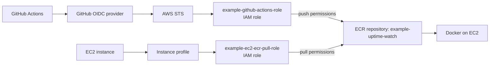

# Technical Reference

## Notes


This is my practical AWS reference for the exact setup I configured around this project. It focuses only on the parts I actually use: EC2, Amazon ECR, IAM trust and permissions, GitHub OIDC, and the authentication boundaries between them.

---

### 1. EC2

My EC2 instance is the runtime host for the application image. It does not own the build pipeline; it pulls the image that GitHub Actions has already published to ECR.

Why it needs an IAM role:

- GitHub Actions publishes the image to ECR.
- EC2 retrieves the image from ECR.
- Those are different responsibilities and should use different AWS identities.

The EC2 role I am using for this is:

```text
uptime-watch-ec2-ecr-pull
```

Status: this role should be verified in AWS before assuming it has already been created and attached to the instance profile.

The role is attached through an EC2 instance profile. The instance profile is what connects the IAM role to the instance. The instance itself does not hold a permanent AWS access key.

Instead, EC2 gets temporary credentials from AWS through the instance metadata service. The AWS CLI on the instance uses those credentials to call AWS APIs.

The operational flow is:

```bash
aws ecr get-login-password --region eu-west-3   | docker login --username AWS --password-stdin     373080580380.dkr.ecr.eu-west-3.amazonaws.com
```

This is the boundary where AWS authentication and Docker authentication are separate but related:

- AWS authentication: the EC2 instance uses its IAM role to get temporary credentials.
- Docker authentication: Docker uses the ECR authorization token to log in to the registry.

To verify the EC2 identity:

```bash
aws sts get-caller-identity
```

This should show a temporary session from the EC2 instance role, not a long-lived IAM user.

Important distinction:

- EC2 instance = the server
- IAM role = the permissions identity attached to the instance
- Instance profile = the attachment mechanism that gives the instance that role

---

### 2. Amazon ECR

My example ECR configuration is:

| Setting        | Value                                          |
| -------------- | ---------------------------------------------- |
| AWS account ID | `123456789012`                                 |
| AWS region     | `eu-west-1`                                    |
| Registry       | `123456789012.dkr.ecr.eu-west-1.amazonaws.com` |
| Repository     | `example-uptime-watch`                         |

I use ECR as the private image registry for my project because GitHub Actions builds the image and EC2 later retrieves it. That keeps the build and runtime responsibilities separate and avoids storing images directly on EC2.

GitHub Actions pushes to:

```text
123456789012.dkr.ecr.eu-west-1.amazonaws.com/example-uptime-watch
```

EC2 pulls from the same repository.

The actual workflow does this:

```yaml
permissions:
  id-token: write
  contents: read
```

```yaml
- name: Configure AWS credentials with OIDC
  uses: aws-actions/configure-aws-credentials@v4
  with:
    role-to-assume: arn:aws:iam::123456789012:role/example-github-actions-role
    aws-region: eu-west-1
```

Then:

```bash
aws ecr get-login-password --region "$AWS_REGION"   | docker login --username AWS --password-stdin "$ECR_REGISTRY"
```

and finally:

```bash
docker build -t "$ECR_REPOSITORY:$IMAGE_TAG" .
docker push "$ECR_REGISTRY/$ECR_REPOSITORY:$IMAGE_TAG"
```

The workflow creates two tags for the same image:

```bash
IMAGE_TAG="upwatch-back-$(date -u +%Y%m%d-%H%M%S)-${GITHUB_SHA:0:7}"
```

Then it also adds:

```bash
docker tag "$ECR_REPOSITORY:$IMAGE_TAG"   "$ECR_REGISTRY/$ECR_REPOSITORY:latest"
```

Result:

```text
example-uptime-watch
├── upwatch-back-20261104-143000-a81f23c
└── latest
```

Those are not two separate image copies. When published together, both tags point to the same underlying image digest. The digest is the real content identity; the tag is just a human-readable label.

Why keep both tags:

- `upwatch-back-...` = specific build, traceable and easy to select
- `latest` = convenient default pointer, but mutable and less precise

For deployment decisions, the version-specific tag is more useful because it identifies a concrete build. `latest` is convenient for quick access, but it is not the best choice when I need to know exactly which image was deployed.

---

### 3. IAM

This is the most important part of the setup.

The key idea is: a role is not enough by itself. The trust policy decides who can assume it, and the permissions policy decides what it can do after it is assumed.

#### 3.1 GitHub OIDC identity provider

I created this identity provider in AWS:

| Setting       | Value                                                                         |
| ------------- | ----------------------------------------------------------------------------- |
| Provider      | `token.actions.githubusercontent.com`                                         |
| Provider type | OpenID Connect                                                                |
| Audience      | `sts.amazonaws.com`                                                           |
| ARN           | `arn:aws:iam::123456789012:oidc-provider/token.actions.githubusercontent.com` |

Why AWS needs it:

- AWS must know that GitHub is a trusted external identity source.
- Without this, GitHub Actions cannot present a workload identity to AWS.

Why this matters for my project:

- GitHub Actions does not use static AWS keys.
- It requests an OIDC token from GitHub.
- AWS STS validates that token and decides whether the workflow is allowed to assume my IAM role.

The flow is:

```text
GitHub Actions
  -> requests OIDC token
  -> GitHub OIDC provider
  -> AWS STS
  -> temporary credentials
  -> workflow can access permitted AWS resources
```

This is safer than long-lived AWS access keys in GitHub secrets because the credentials are temporary and tied to a specific repository and branch.

#### 3.2 GitHub Actions IAM role

Role:

```text
example-github-actions-role
arn:aws:iam::123456789012:role/example-github-actions-role
```

This role allows GitHub Actions to authenticate to AWS and push the Docker image to ECR.

Trust policy:

```json
{
  "Version": "2012-10-17",
  "Statement": [
    {
      "Effect": "Allow",
      "Principal": {
        "Federated": "arn:aws:iam::123456789012:oidc-provider/token.actions.githubusercontent.com"
      },
      "Action": "sts:AssumeRoleWithWebIdentity",
      "Condition": {
        "StringEquals": {
          "token.actions.githubusercontent.com:aud": "sts.amazonaws.com",
          "token.actions.githubusercontent.com:sub": "repo:ExampleOrg@example-repo@123456789:ref:refs/heads/main"
        }
      }
    }
  ]
}
```

What this controls:

- trusted principal = GitHub OIDC provider
- action = `sts:AssumeRoleWithWebIdentity`
- audience must be `sts.amazonaws.com`
- subject must match this exact GitHub repository and branch

This means GitHub can assume the role only if the token is for my repo and for `main`.

The repository identity in the trust policy is:

```text
Repository: ExampleOrg/example-repo
Owner ID: 123456789
Repository ID: 123456789
Branch: main
```

The numeric owner and repo identifiers are included so AWS can match the exact GitHub identity rather than accepting a looser repository name pattern.

Permissions policy:

```json
{
  "Version": "2012-10-17",
  "Statement": [
    {
      "Sid": "AllowEcrAuthorization",
      "Effect": "Allow",
      "Action": "ecr:GetAuthorizationToken",
      "Resource": "*"
    },
    {
      "Sid": "AllowRepositoryPush",
      "Effect": "Allow",
      "Action": [
        "ecr:DescribeRepositories",
        "ecr:BatchCheckLayerAvailability",
        "ecr:InitiateLayerUpload",
        "ecr:UploadLayerPart",
        "ecr:CompleteLayerUpload",
        "ecr:PutImage"
      ],
      "Resource": "arn:aws:ecr:eu-west-1:123456789012:repository/example-uptime-watch"
    }
  ]
}
```

Why these permissions are needed:

- `ecr:GetAuthorizationToken` is a registry-level request, so it is allowed with `Resource: "*"`.
- The other actions are repository-scoped to my ECR repository.
- This role is allowed to push images, not read from the repository for normal deployment actions.

This distinction matters:

- Trust policy decides whether GitHub can assume the role.
- Permissions policy decides whether the assumed identity can push an image.

A role can be trusted and still fail if it lacks the required ECR permissions.

#### 3.3 EC2 IAM role

Role:

```text
example-ec2-ecr-pull-role
```

Status: this role is a sample setup for a runtime pull identity and does not reflect a live AWS configuration.

This role is different from the GitHub role because it is for runtime image retrieval, not image publishing.

Trust policy:

```json
{
  "Version": "2012-10-17",
  "Statement": [
    {
      "Effect": "Allow",
      "Principal": {
        "Service": "ec2.amazonaws.com"
      },
      "Action": "sts:AssumeRole"
    }
  ]
}
```

This trusts the EC2 service, not GitHub. AWS allows the EC2 service to assume the role when the instance is running. The instance profile is the mechanism that attaches that role to the instance.

Permissions policy:

```json
{
  "Version": "2012-10-17",
  "Statement": [
    {
      "Sid": "AllowEcrAuthorization",
      "Effect": "Allow",
      "Action": "ecr:GetAuthorizationToken",
      "Resource": "*"
    },
    {
      "Sid": "AllowRepositoryPull",
      "Effect": "Allow",
      "Action": [
        "ecr:BatchCheckLayerAvailability",
        "ecr:BatchGetImage",
        "ecr:GetDownloadUrlForLayer"
      ],
      "Resource": "arn:aws:ecr:eu-west-1:123456789012:repository/example-uptime-watch"
    }
  ]
}
```

Why this role only pulls:

- EC2 is allowed to authenticate to ECR and download image layers.
- It does not need image-publishing permissions.
- `ecr:GetAuthorizationToken` still uses `Resource: "*"` because it is a registry-level authorization request.
- The layer and manifest retrieval permissions are scoped to the repository that contains the image.

This is the main difference from the GitHub role:

- GitHub role = assume via GitHub OIDC, then push to ECR
- EC2 role = assume via EC2 service, then pull from ECR

---

### 4. How everything works together

#### Flow A — Publishing an image

1. I push or merge code into `main`.
2. GitHub Actions starts the workflow.
3. GitHub Actions requests an OIDC identity token.
4. AWS STS validates the token against the GitHub role trust policy.
5. GitHub Actions assumes `example-github-actions-role`.
6. AWS provides temporary credentials to the workflow.
7. The workflow authenticates Docker to ECR.
8. Docker pushes the image and tags to the ECR repository.
9. ECR stores the image and tag metadata.

#### Flow B — Retrieving an image

1. I run the deployment script on EC2.
2. AWS CLI gets temporary credentials from the instance role.
3. EC2 authenticates Docker to ECR.
4. Docker requests the image from the registry.
5. AWS checks the EC2 role permissions.
6. ECR allows the pull if the role is authorized for that repository.
7. Docker downloads the image layers and stores the image locally.
8. Docker Compose uses that image to start or recreate the application container.

At each boundary, the trust and permission model matters:

- OIDC provider validates GitHub identity
- trust policy decides whether the GitHub role can be assumed
- permissions policy decides whether the role can push images
- instance profile gives EC2 its role
- EC2 permissions decide whether it can pull images



The important part is that GitHub and EC2 use different roles for different jobs, even though they both talk to the same ECR repository.

---

### 5. Quick reference

| Item                 | Value                                                                         |
| -------------------- | ----------------------------------------------------------------------------- |
| AWS account ID       | `123456789012`                                                                |
| AWS region           | `eu-west-1`                                                                   |
| ECR registry         | `123456789012.dkr.ecr.eu-west-1.amazonaws.com`                                |
| ECR repository       | `example-uptime-watch`                                                        |
| GitHub OIDC provider | `arn:aws:iam::123456789012:oidc-provider/token.actions.githubusercontent.com` |
| GitHub role          | `arn:aws:iam::123456789012:role/example-github-actions-role`                  |
| EC2 role             | `example-ec2-ecr-pull-role` (sample setup)                                    |

Verify AWS identity:

```bash
aws sts get-caller-identity
```

Check the ECR repository:

```bash
aws ecr describe-repositories   --repository-names example-uptime-watch   --region eu-west-1
```

Check image metadata and digests:

```bash
aws ecr describe-images   --repository-name example-uptime-watch   --region eu-west-1   --output table
```

List the tags in the repository:

```bash
aws ecr list-images   --repository-name example-uptime-watch   --region eu-west-1
```

Authenticate Docker to ECR:

```bash
aws ecr get-login-password --region eu-west-1   | docker login --username AWS --password-stdin     123456789012.dkr.ecr.eu-west-1.amazonaws.com
```

### 6. EC2 Storage Expansion — Troubleshooting "No space left on device"

The actual error:

```text
failed to extract layer ... to overlayfs:
write /var/lib/containerd/...:
no space left on device
```

#### 1. What I checked first

```bash
df -h
docker system df
sudo du -sh /var/lib/containerd
sudo du -sh /var/lib/docker
```

Actual output:

```text
Filesystem       Size  Used Avail Use% Mounted on
/dev/root        6.7G  4.0G  2.7G  61% /

TYPE            TOTAL     ACTIVE    SIZE      RECLAIMABLE
Images          2         2         839.3MB   0B (0%)
Containers      2         2         3.523MB   0B (0%)
Local Volumes   0         0         0B        0B
Build Cache     0         0         0B        0B

808M    /var/lib/containerd
597M    /var/lib/docker
```

The root filesystem only had `2.7G` free. Docker also had no reclaimable storage, so pruning was not the real fix. The bigger issue was that the host disk was simply too small for the image extraction step.

#### 2. What I confirmed before changing anything

```bash
docker ps -a
docker images
sudo lsblk
```

Relevant output:

```text
uptime-watch-app
uptime-watch-nginx

IMAGE                                      DISK USAGE
uptime-watch:latest                        765MB
nginx:1.27-alpine                          74.5MB

NAME         SIZE TYPE MOUNTPOINTS
nvme0n1       8G disk
├─nvme0n1p1  6.9G part /
├─nvme0n1p13 1023M part /boot
├─nvme0n1p14   4M part
└─nvme0n1p15  106M part /boot/efi
```

The disk looked 8 GB from AWS, but the root partition was only 6.9 GB. The root filesystem still had to be expanded.

The mental model was:

```text
EBS Volume → Partition → Filesystem
```

Increasing the EBS volume alone does not make extra space available to Linux. The partition and filesystem must also be resized.

#### 3. Fix that worked

Increase the EBS volume in AWS, then resize the root partition:

```bash
sudo growpart /dev/nvme0n1 1
```

Actual output:

```text
CHANGED: partition=1 start=2324480
old: size=14452703 end=16777182
new: size=22841311 end=25165790
```

Then expand the ext4 filesystem:

```bash
sudo resize2fs /dev/nvme0n1p1
```

Actual output:

```text
resize2fs 1.47.2 (1-Jan-2025)
Filesystem at /dev/nvme0n1p1 is mounted on /;
on-line resizing required
old_desc_blocks = 1, new_desc_blocks = 2
The filesystem on /dev/nvme0n1p1 is now 2855163 (4k) blocks long.
```

After resizing, the root filesystem was back to a healthy state:

```bash
df -h
df -hT
lsblk
```

Final relevant output:

```text
Filesystem       Size  Used Avail Use% Mounted on
/dev/root         11G  4.6G  6.0G  44% /
```

| Metric          | Before | After   |
| --------------- | ------ | ------- |
| Root partition  | 6.9 GB | 10.9 GB |
| Root filesystem | 6.7 GB | 11 GB   |
| Available space | 2.7 GB | 6.0 GB  |
| Usage           | 61%    | 44%     |

#### 4. Quick reminder

```bash
df -h
df -hT
lsblk
sudo growpart /dev/nvme0n1 1
sudo resize2fs /dev/nvme0n1p1
```

When this happens again, the workflow is:

```text
check free space → inspect Docker storage → inspect block devices → resize EBS → grow partition → resize filesystem → verify → retry deployment
```

#### 5. Lessons to keep

- `no space left on device` during pull/extract usually means local disk, not registry auth.
- Docker and containerd storage lives on the EC2 host filesystem.
- Expanding AWS volume size is only the first step; the partition and filesystem must also be expanded.
- `lsblk` is the first truth source before resizing.
- `resize2fs` is for ext filesystems; XFS uses another procedure.
- Never assume Docker cleanup is the solution when the root filesystem is the real bottleneck.

---

### 6. Amazon RDS integration

#### 1. VPC and private networking

A VPC is the AWS network boundary for the resources that belong together. EC2, RDS, subnets, route tables, and security groups all live inside a VPC, and the resources need to be in the same network context to talk to each other. In this project, the EC2 instance and the PostgreSQL database are in the same VPC in `eu-west-3`, so their private networking can work without exposing the database to the internet.

The practical reason this matters is simple: the app runs in a Docker container on EC2, but the database is not on the same machine or the same Docker network. The database is reached through the VPC and its private endpoint. The actual path is:

```text
Django container → EC2 host/network → VPC → RDS private endpoint → PostgreSQL
```

This is not Docker networking. It is AWS networking. The RDS endpoint is a private DNS name that resolves to a private IP inside the VPC, not a public address. A private IP is only routable inside the VPC and related network paths; it is not reachable from the public internet by default. That is why RDS can be private and still reachable from the application while not being publicly accessible.

The DNS piece matters because clients do not connect to a fixed IP; they connect to the hostname. For this instance, the endpoint is:

```text
uptime-watch-db-prod.cvi446um23kl.eu-west-3.rds.amazonaws.com
```

That hostname resolves in the VPC to the observed private IP:

```text
172.31.48.73
```

So the app resolves the RDS endpoint to a private address, then connects over the VPC network to the PostgreSQL service. The AWS region is `eu-west-3`, and the name is tied to the specific RDS instance created for this project.

#### 2. Security groups

A security group is a virtual firewall attached to an AWS resource. It is not a separate host firewall; it is the access policy that controls network traffic to and from the resource. Inbound rules decide what is allowed to enter; outbound rules decide what the resource is allowed to send out. For this project, security groups are the reason EC2 can reach RDS on PostgreSQL without exposing the database publicly.

Security groups are stateful. If EC2 initiates a TCP connection to PostgreSQL on port 5432, the response traffic is automatically allowed back in without needing a separate inbound rule for that response. This is why EC2 does not need a separate inbound PostgreSQL rule just to receive replies; the connection is already tracked as part of the allowed session.

My actual setup was:

| Security group | Type       | Protocol | Port   | Rule direction | Source / destination     |
| -------------- | ---------- | -------- | ------ | -------------- | ------------------------ |
| `ec2-rds-1`    | PostgreSQL | TCP      | `5432` | Outbound       | Destination: `rds-ec2-1` |
| `rds-ec2-1`    | PostgreSQL | TCP      | `5432` | Inbound        | Source: `ec2-rds-1`      |

This is the connection model I used:

- The EC2 security group `ec2-rds-1` allows outbound PostgreSQL traffic on TCP `5432`.
- The RDS security group `rds-ec2-1` allows inbound PostgreSQL traffic on TCP `5432` only from the EC2 security group.
- The RDS inbound rule is essential because RDS is the resource being reached; without it, the database would reject the connection even if EC2 had a valid outbound rule.

Using another security group as the source/destination is more practical than hardcoding a single EC2 private IP. If the instance changes, the security group still represents the correct identity for the allowed traffic. In other words, the rule says “allow traffic from EC2 instances in this security group” instead of “allow traffic from this specific IP address.”

It is also worth noting that allowing all outbound traffic on EC2 would permit the connection as well, but an explicit outbound rule to RDS on port 5432 is more restrictive and clearer. It documents the intended database path instead of relying on a broad default.

#### 3. Testing network connectivity with Netcat

`nc` is Netcat: a small utility for testing TCP and UDP connectivity to a host and port. I used it when I wanted to confirm that the RDS hostname resolved and that the database listener was reachable on PostgreSQL port 5432, without sending any SQL or application payloads.

The command I executed was:

```bash
nc -zv uptime-watch-db-prod.cvi446um23kl.eu-west-3.rds.amazonaws.com 5432
```

What the flags mean:

- `nc`: Netcat
- `-z`: scan for a listening port without sending data
- `-v`: verbose output
- `uptime-watch-db-prod.cvi446um23kl.eu-west-3.rds.amazonaws.com`: destination hostname
- `5432`: PostgreSQL port

The successful output was:

```text
Connection to uptime-watch-db-prod.cvi446um23kl.eu-west-3.rds.amazonaws.com
(172.31.48.73) 5432 port [tcp/postgresql] succeeded!
```

This confirms several useful things:

- DNS resolution works for the RDS hostname.
- The hostname resolves to the private IP `172.31.48.73`.
- The target is reachable over TCP.
- Port `5432` is accepting connections.

This does not confirm:

- PostgreSQL credentials are valid.
- The database exists.
- SQL queries can execute successfully.
- The application can run database operations correctly.

So `nc` is a network-layer validation. It proves that the path is open and reachable, not that the PostgreSQL service is fully usable for application logic.

#### 4. Amazon RDS PostgreSQL: configuration and terminology

These are the terms that matter for my actual setup and they are easy to mix up if I am not careful.

##### DB instance identifier

The DB instance identifier is the AWS-side name for the RDS resource itself. It is the identifier used to create the database service in AWS and it appears in the generated endpoint. For this project, the DB instance identifier is:

```text
uptime-watch-db-prod
```

That name is used to generate the full endpoint:

```text
uptime-watch-db-prod.cvi446um23kl.eu-west-3.rds.amazonaws.com
```

##### Endpoint

The endpoint is the hostname clients use to connect to the RDS service. It is generated by AWS and resolves to the database’s private IP inside the VPC. In this case, it resolves to:

```text
172.31.48.73
```

The endpoint is what the application and tools use to reach the database; the DB instance identifier is the AWS resource name behind it.

##### Database name

The database name is not the same as the DB instance identifier. The database name identifies an individual PostgreSQL database inside the PostgreSQL server. One RDS PostgreSQL instance can contain multiple databases, while the DB instance identifier refers to the managed database server resource itself. In practice, the server is the RDS instance and the database is the logical PostgreSQL database inside it.

##### Master username

The master username is the primary administrative login configured when the RDS instance was created. In my testing, I used:

```text
postgres
```

This was the PostgreSQL username used for the connection test. The master user is a database user created by RDS, but it is not an unrestricted PostgreSQL superuser. That distinction matters when I interpret `Superuser: off` in the connection metadata.

##### Port

PostgreSQL uses port `5432` by default. In this setup, the database listener is reachable on that port, and the connection string uses the same port for both the network test and the SQL check.

These values fit together like this:

```text
host = uptime-watch-db-prod.cvi446um23kl.eu-west-3.rds.amazonaws.com
port = 5432
user = postgres
database = postgres
```

That is the basic shape of a PostgreSQL connection for this RDS instance.

#### 5. Testing PostgreSQL authentication and SSL with psql

I used `psql` to confirm that I could authenticate to the PostgreSQL service and that the connection was protected by SSL/TLS. The command was:

```bash
psql \
  -h uptime-watch-db-prod.cvi446um23kl.eu-west-3.rds.amazonaws.com \
  -p 5432 \
  -U postgres \
  -d postgres
```

What each option does:

- `-h`: PostgreSQL server hostname
- `-p`: server port
- `-U`: PostgreSQL username to authenticate as
- `-d`: database name to connect to

I intentionally used `postgres` for both the username and database name, but these are independent values. They only happen to be the same in this test. The important point is that the username and default database are separate configuration inputs, even when they match.

Once connected, the useful commands I used were:

```sql
SELECT version();
\conninfo
\l
\dt
\q
```

What they tell me:

- `SELECT version();` shows the PostgreSQL server version and build information.
- `\conninfo` shows the active connection details and the endpoint the client is using.
- `\l` lists databases on the server.
- `\dt` lists tables in the current schema.
- `\q` exits `psql`.

The observed connection information was:

```text
Database             | postgres
Client User          | postgres
Host                 | uptime-watch-db-prod.cvi446um23kl.eu-west-3.rds.amazonaws.com
Host Address         | 172.31.48.73
Server Port          | 5432
Password Used        | true
SSL Connection       | true
SSL Protocol         | TLSv1.3
Superuser            | off
```

This tells me a few important things:

- The hostname resolved and the connection reached the RDS private endpoint.
- Password-based authentication succeeded.
- The transport is encrypted with TLS.
- The server is using PostgreSQL over SSL/TLS with `TLSv1.3`.
- The master account is not a PostgreSQL superuser, even though it is the administrative RDS account.

One useful distinction here is that the client and server PostgreSQL versions may be different. The `SELECT version();` output shows the server-side version, while the client version is what the local `psql` binary reports. The important validation is not that both versions match; it is that the connection is accepted and encrypted and that the authentication path is working.

This is the practical boundary for the RDS work: the network path is validated first, then the database login is validated, and then the encrypted PostgreSQL session itself is confirmed. These checks answer different questions and should be interpreted separately.

---
